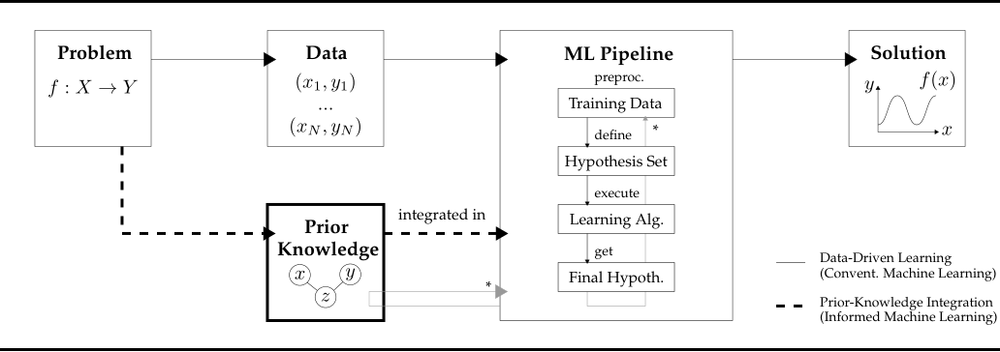

# Informed ML · 数据路径与先验知识路径的概念对照

<!-- CATEGORY NAV -->
[Teaser](../README.md) · [Architecture](../../architecture/README.md) · [Element](../../element/README.md) · [总目录](../../CATALOG.md)
<!-- END CATEGORY NAV -->

[所属分类](../README.md) · [总目录](../../CATALOG.md)

**arXiv 2019 · 综述 · 原论文 Figure 1**

## 子图组织

问题—数据—学习—解答的主路径，配独立先验知识路径；学习流程内部展开 4 个位置。

两条路径对应作者图例中的数据驱动学习与先验知识融合；流程内部四阶段是 Training Data、Hypothesis Set、Learning Algorithm、Final Hypothesis。

## 为什么收这张图

把传统数据路径和独立先验知识路径画在同一信息流中，通过实线、虚线和内部阶段展开解释融合发生在哪里。简洁的结构承载清楚的方法差异。

综述 Figure 1。作为数据与知识融合的概念首图参考，与 AI4PDE Fig.2 的物理—数据方法对照形成互补。

## 相近表达

明确区分数据与先验知识，并解释两者如何进入学习过程。 对照查看：[AI4PDE 综述范例](../survey-ai-pde-physics-data-paradigms/README.md)。

## 可以借鉴

- 保持主路径清楚，将新增知识路径作为第二条可追踪的信息流。
- 内部流程只展开到足以说明融入位置的粒度。
- 图例解释线型语义，避免将不同路径混成装饰性箭头。

## 可美化的方向（尚未改绘）

- 可使用少量颜色区分两条信息来源，同时保留线型差异。
- 对齐主流程模块，压缩图例占用的空白。

## 文件与编辑范围

[作者原始 PDF](original.pdf) · [SVG 转换件](source.svg) · [原始插图定义](figure-inclusion.tex) · [来源与校验记录](metadata.json)

独立 PDF 保留作者原有矢量图形、连线和文本对象；SVG 文字转轮廓。此独立 PDF 未检测到嵌入位图。

原件来自作者固定版本源码归档；桌面 Illustrator 尚未逐项实测。

## 原始出处

- 论文：[Informed Machine Learning -- A Taxonomy and Survey of Integrating Knowledge into Learning Systems](https://arxiv.org/abs/1903.12394v3)
- 作者：von Rueden, Laura；Mayer, Sebastian；Beckh, Katharina；Georgiev, Bogdan；Giesselbach, Sven；Heese, Raoul；Kirsch, Birgit；Pfrommer, Julius；Pick, Annika；Ramamurthy, Rajkumar；Walczak, Michal；Garcke, Jochen；Bauckhage, Christian；Schuecker, Jannis
- [作者项目或原文](https://arxiv.org/abs/1903.12394)
- [作者 TeX 源码归档](https://arxiv.org/src/1903.12394v3)；版本 `1903.12394v3`。
- 归档内路径：`figures/central_figures/fig_iml_concept_v8b_201012_compiled.pdf`。原文 PDF 第 2 页，Figure 1。

## 权利与修改记录

所收录版本声明 CC BY 4.0；保留作者署名、原文链接与转换记录。 子图引用的第三方照片、截图、生成结果与原论文图例仍按其原始权利声明使用。

[原文许可声明](https://creativecommons.org/licenses/by/4.0/) · [权利记录](RIGHTS.source.txt)

只复制原件、转换格式和制作预览；所有内容沿用作者原图。

<!-- BEGIN FIGURE LINKS -->
## 关联范例与元素

同论文的其他图：[Informed ML · 知识来源—表示—融入位置全景](../survey-informed-ml-knowledge-map/README.md)

**可搭配的现有元素：** [数据库](../../element/svg/tabler-database.svg) · [浅层神经网络](../../element/svg/towaki-neuralnetwork.svg) · [右箭头](../../element/svg/tabler-arrow-right.svg) · [节点分支](../../element/svg/tabler-affiliate.svg)

这些元素按表达功能关联，并非从本论文原图拆出；来源和许可仍以各元素记录为准。

[范例与元素对照表](../../element/with-examples.md) · [元素分类目录](../../element/README.md)
<!-- END FIGURE LINKS -->
