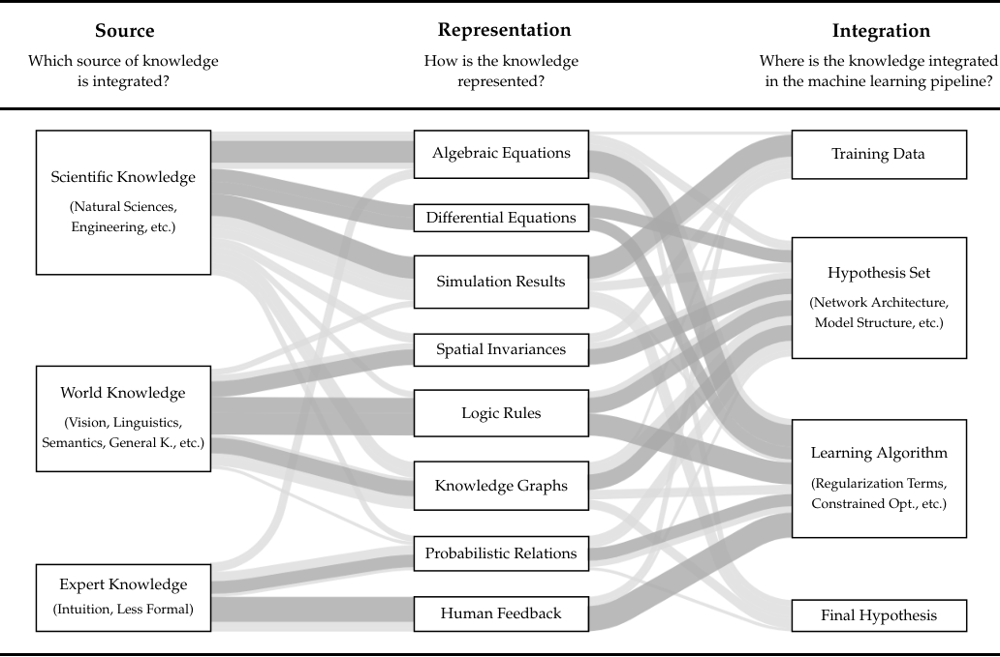

# Informed ML · 知识来源—表示—融入位置全景

<!-- CATEGORY NAV -->
[Teaser](../README.md) · [Architecture](../../architecture/README.md) · [Element](../../element/README.md) · [总目录](../../CATALOG.md)
<!-- END CATEGORY NAV -->

[所属分类](../README.md) · [总目录](../../CATALOG.md)

**arXiv 2019 · 综述 · 原论文 Figure 2**

## 子图组织

3 类知识来源 → 8 类知识表示 → 4 个学习流程融入位置。

按三列命名节点分别计数。连接带的宽度对应作者所分析文献中的相对数量，属于该版本的文献统计；不能仅当装饰性连线。

## 为什么收这张图

三列分别回答知识来自哪里、如何表示、在哪里进入学习流程。Sankey 连接将分类目录变成关系全景，能够同时展示多个类别以及它们之间的联系。

综述 Figure 2 的分类全景。与 AI4PDE Fig.1 同样用多层分类和连接关系交代研究范围。

## 相近表达

将多级分类串成完整的领域关系图，适合表达研究范围与组成。 对照查看：[AI4PDE 综述范例](../survey-ai-pde-scope-map/README.md)。

## 可以借鉴

- 每列回答一个明确问题，使复杂分类保持稳定的阅读顺序。
- 将节点类型与连接关系同时表达，避免只列名称。
- 分清概念关系和带宽所表示的文献统计，改编时应重新核对。

## 可美化的方向（尚未改绘）

- 可为三个层级或主要路径使用克制的配色，保持文字对比度。
- 保留足够列间距离，避免连线与节点标签相互遮挡。

## 文件与编辑范围

[作者原始 PDF](original.pdf) · [SVG 转换件](source.svg) · [原始插图定义](figure-inclusion.tex) · [来源与校验记录](metadata.json)

独立 PDF 保留作者原有图形和文本对象；SVG 文字转轮廓。原图中的嵌入位图可移动或替换，不能按矢量节点编辑。

作者 PDF 中两列之间的 Sankey 连接带已保存为两幅位图，节点框和文字保留原有矢量与文本对象。SVG 转换没有把连接带恢复为可独立编辑的曲线。

原件来自作者固定版本源码归档；桌面 Illustrator 尚未逐项实测。

## 原始出处

- 论文：[Informed Machine Learning -- A Taxonomy and Survey of Integrating Knowledge into Learning Systems](https://arxiv.org/abs/1903.12394v3)
- 作者：von Rueden, Laura；Mayer, Sebastian；Beckh, Katharina；Georgiev, Bogdan；Giesselbach, Sven；Heese, Raoul；Kirsch, Birgit；Pfrommer, Julius；Pick, Annika；Ramamurthy, Rajkumar；Walczak, Michal；Garcke, Jochen；Bauckhage, Christian；Schuecker, Jannis
- [作者项目或原文](https://arxiv.org/abs/1903.12394)
- [作者 TeX 源码归档](https://arxiv.org/src/1903.12394v3)；版本 `1903.12394v3`。
- 归档内路径：`figures/central_figures/fig_taxonomy_v15_210311_compiled.pdf`。原文 PDF 第 4 页，Figure 2。

## 权利与修改记录

所收录版本声明 CC BY 4.0；保留作者署名、原文链接与转换记录。 子图引用的第三方照片、截图、生成结果与原论文图例仍按其原始权利声明使用。

[原文许可声明](https://creativecommons.org/licenses/by/4.0/) · [权利记录](RIGHTS.source.txt)

只复制原件、转换格式和制作预览；所有内容沿用作者原图。

<!-- BEGIN FIGURE LINKS -->
## 关联范例与元素

同论文的其他图：[Informed ML · 数据路径与先验知识路径的概念对照](../survey-informed-ml-information-flow/README.md)

**可搭配的现有元素：** [层级结构](../../element/svg/tabler-sitemap.svg) · [节点分支](../../element/svg/tabler-affiliate.svg) · [大脑](../../element/svg/tabler-brain.svg) · [数据库](../../element/svg/tabler-database.svg)

这些元素按表达功能关联，并非从本论文原图拆出；来源和许可仍以各元素记录为准。

[范例与元素对照表](../../element/with-examples.md) · [元素分类目录](../../element/README.md)
<!-- END FIGURE LINKS -->
