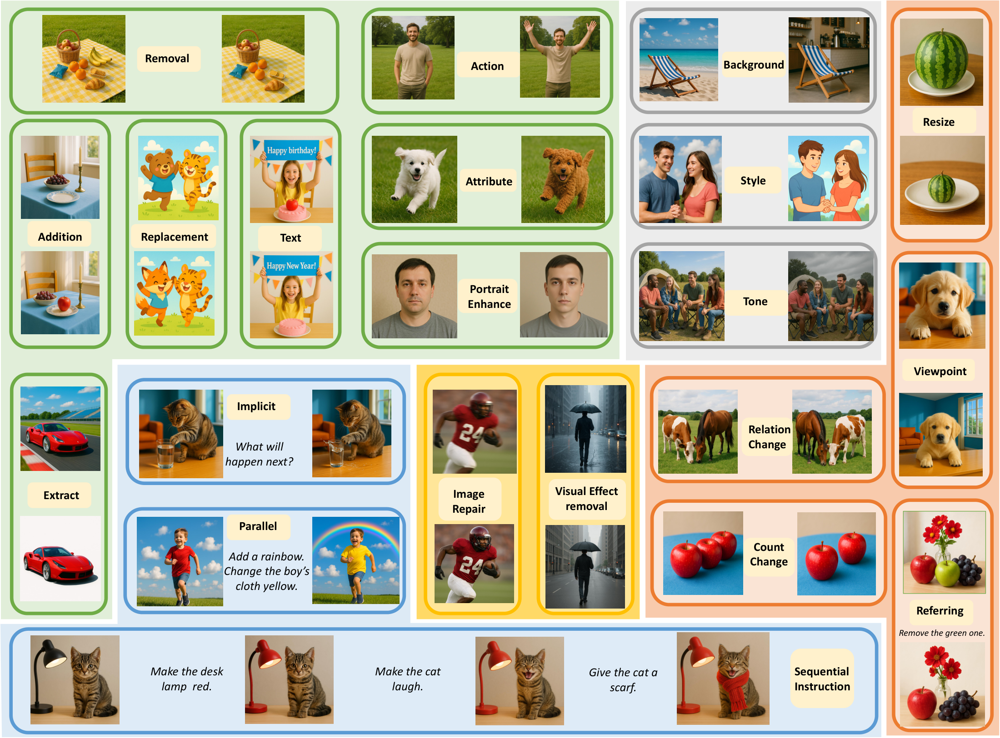

# 指令式图像编辑 · 21 种任务的多子图总览

<!-- CATEGORY NAV -->
[Teaser](../README.md) · [Architecture](../../architecture/README.md) · [Element](../../element/README.md) · [总目录](../../CATALOG.md)
<!-- END CATEGORY NAV -->

[所属分类](../README.md) · [总目录](../../CATALOG.md)

**arXiv 2026 · 综述 · 原论文 Figure 2**

## 子图组织

21 个任务子图，按 5 类操作分区；共 44 张输入或结果图。

按 Removal、Addition 等任务标签计 21 个子图；顺序编辑面板含 4 张状态图，其余面板各为一组前后对照。

## 为什么收这张图

21 个任务子图按五类操作组织，每个小面板保留输入、编辑结果和短标签；颜色只分大类，横排、竖排与底部长条配合，内容密集且层次清楚。

综述 Figure 2 的任务全景参考，原文并非首图。适合借鉴为多任务综述 teaser 的布局，不把示意样例当作同一模型的定量比较。

## 可以借鉴

- 每个任务沿用相同的前后对照逻辑，同时根据图像比例选择横排或竖排。
- 大色块区分五类任务，小圆框区分具体操作，避免 21 个子图看成杂乱拼贴。
- 顺序编辑使用横向长条，既完整呈现多个状态，也形成整张图的底部收束。

## 文件与编辑范围

[作者原始 PDF](original.pdf) · [SVG 转换件](source.svg) · [原始插图定义](figure-inclusion.tex) · [来源与校验记录](metadata.json)

独立 PDF 保留作者原有图形和文本对象；SVG 文字转轮廓。各照片与结果图仍是嵌入位图，可移动或替换，不能按矢量节点编辑。

原件来自作者固定版本源码归档；桌面 Illustrator 尚未逐项实测。

## 原始出处

- 论文：[Instruction-based Image Editing: A Survey on Data, Models, Evaluation, and Applications](https://arxiv.org/abs/2607.25642v1)
- 作者：Zang, Xianghao；Jiang, Zijian；Cheng, Jiarong；Teng, Qianrui；He, Ying；Mu, Yuxuan；Ban, Chao；Zhang, Huayu；Zhou, Lanxiang；Feng, Zerun；Zhang, Chi
- [作者项目或原文](https://arxiv.org/abs/2607.25642)
- [作者 TeX 源码归档](https://arxiv.org/src/2607.25642v1)；版本 `2607.25642v1`。
- 归档内路径：`task_show.pdf`。原文 PDF 第 7 页，Figure 2。

## 权利与修改记录

所收录版本的 arXiv 非独占分发许可不是第三方图形重用许可；此条用于个人私有参考，公开改编或再用需核对原权利。 子图引用的第三方照片、截图、生成结果与原论文图例仍按其原始权利声明使用。

[原文许可声明](https://arxiv.org/licenses/nonexclusive-distrib/1.0/) · [权利记录](RIGHTS.source.txt)

只复制原件、转换格式和制作预览；所有内容沿用作者原图。

<!-- BEGIN FIGURE LINKS -->
## 关联范例与元素

**可搭配的现有元素：** [图像](../../element/svg/tabler-photo.svg) · [文本文件](../../element/svg/tabler-file-text.svg) · [水平双向箭头](../../element/svg/tabler-arrows-right-left.svg) · [右箭头](../../element/svg/tabler-arrow-right.svg)

这些元素按表达功能关联，并非从本论文原图拆出；来源和许可仍以各元素记录为准。

[范例与元素对照表](../../element/with-examples.md) · [元素分类目录](../../element/README.md)
<!-- END FIGURE LINKS -->
