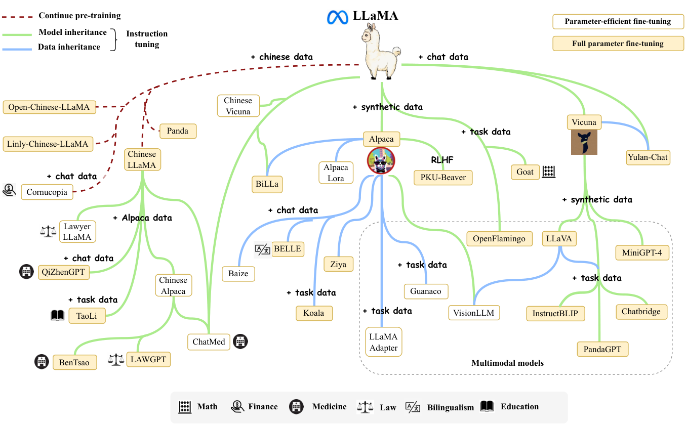

# LLaMA 家族关系 · 模型与数据继承图

<!-- CATEGORY NAV -->
[Teaser](../README.md) · [Architecture](../../architecture/README.md) · [Element](../../element/README.md) · [总目录](../../CATALOG.md)
<!-- END CATEGORY NAV -->

[所属分类](../README.md) · [总目录](../../CATALOG.md)

**Frontiers of Computer Science 2026 · 期刊综述 · 原论文 Figure 5**

## 为什么收这张图

把模型继承、数据继承与继续预训练画成不同颜色和线型的关系，从单一根节点展开出任务与领域分支，重点是关系而非枚举。

综述中的谱系总览图，适合表达一个基础模型如何衍生出多个研究方向。

## 可以借鉴

- 颜色与虚实分别表达关系语义，并保留清楚的图例。
- 用虚线范围框归并多模态分支，用底部小图例标注应用领域。
- 保留原图的早期 LLaMA 生态范围；图中模型与关系不可直接当作当前全景。

## 文件与编辑范围

[作者原始 PDF](original.pdf) · [SVG 转换件](source.svg) · [原始 LaTeX 插图定义](figure-inclusion.tex) · [来源与校验记录](metadata.json)

作者独立 PDF 中的文字与图形对象保留；SVG 文字转为轮廓。原有照片、标识、人物或渲染仍为嵌入位图，可移动替换，不能按矢量节点编辑。

对照原论文页核实了图号和实际用途；独立 PDF 按作者提交的原文件保存。

原始 PDF 来自作者提交的 TeX 归档，未改字节；SVG 是格式转换件，未取得原生 AI 工程。桌面 Illustrator 尚未逐项实测。

## 原始出处

- 论文：[A Survey of Large Language Models](https://arxiv.org/abs/2303.18223v19)
- 作者：Zhao, Wayne Xin, Zhou, Kun, Li, Junyi, Tang, Tianyi, Wang, Xiaolei, Hou, Yupeng, Min, Yingqian, Zhang, Beichen, Zhang, Junjie, Dong, Zican, Du, Yifan, Yang, Chen, Chen, Yushuo, Chen, Zhipeng, Jiang, Jinhao, Ren, Ruiyang, Li, Yifan, Tang, Xinyu, Liu, Zikang, Liu, Peiyu, Nie, Jian-Yun, Wen, Ji-Rong
- [作者项目或仓库](https://github.com/RUCAIBox/LLMSurvey)
- [论文 TeX 原始归档](https://arxiv.org/src/2303.18223v19)，固定版本 `2303.18223v19`。
- 归档内路径：`images/llama-0628-final.pdf`；原文 PDF 第 12 页，Figure 5。
- [出版与来源依据](https://arxiv.org/abs/2303.18223v19)；出版年份与所收录 arXiv 修订版时间分别记录。

## 权利与修改记录

该 arXiv 版本的非独占分发许可不是第三方图形重用许可；此条用于个人私有参考，公开改编或再用应核对原权利。 作者在论文和项目中明确保留图表权利，并要求出版使用取得作者许可。

[原文许可声明](https://arxiv.org/licenses/nonexclusive-distrib/1.0/) · [本条权利记录](RIGHTS.source.txt)

只复制作者原件、转换格式和制作预览；没有重绘或新增图形。

<!-- BEGIN FIGURE LINKS -->
## 关联范例与元素

同论文的其他图：[语言模型四代能力演进 · 阶梯式概念图](../survey-lm-capability-evolution/README.md) · [LLM 发布脉络 · 主轴与时间分支](../survey-llm-release-timeline/README.md)

**可搭配的现有元素：** [层级结构](../../element/svg/tabler-sitemap.svg) · [节点分支](../../element/svg/tabler-affiliate.svg) · [分流箭头](../../element/svg/tabler-arrows-split.svg)

这些元素按表达功能关联，并非从本论文原图拆出；来源和许可仍以各元素记录为准。

[范例与元素对照表](../../element/with-examples.md) · [元素分类目录](../../element/README.md)
<!-- END FIGURE LINKS -->
