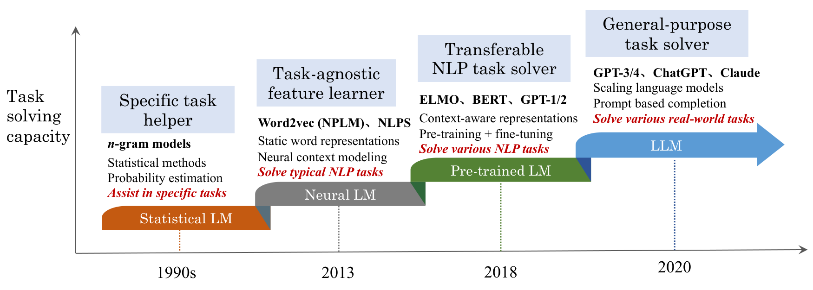

# 语言模型四代能力演进 · 阶梯式概念图

<!-- CATEGORY NAV -->
[Teaser](../README.md) · [Architecture](../../architecture/README.md) · [Element](../../element/README.md) · [总目录](../../CATALOG.md)
<!-- END CATEGORY NAV -->

[所属分类](../README.md) · [总目录](../../CATALOG.md)

**Frontiers of Computer Science 2026 · 期刊综述 · 原论文 Figure 2**

## 为什么收这张图

用同一条阶梯和时间轴，把统计语言模型、神经语言模型、预训练语言模型与大语言模型的任务能力变化串起来；一眼先读到观点，再读阶段细节。

综述中的概念演进图；突出领域视角和阶段差异，适合作为综述 teaser 的构图参考。不是网络架构图。

## 可以借鉴

- 用阶梯高度表达能力范围，用横轴表达阶段，避免把概念演进堆成论文列表。
- 每一阶段复用相同的信息层级：名称、代表工作、关键机制、任务范围。
- 图中年份与分类是作者在所收录版本中的划分，改编时应重新核对。

## 文件与编辑范围

[作者原始 PDF](original.pdf) · [SVG 转换件](source.svg) · [原始 LaTeX 插图定义](figure-inclusion.tex) · [来源与校验记录](metadata.json)

作者独立 PDF 中的文字与图形对象保留；SVG 文字转为轮廓。这张独立原图未检出嵌入位图。

对照原论文页核实了图号和实际用途；独立 PDF 按作者提交的原文件保存。

原始 PDF 来自作者提交的 TeX 归档，未改字节；SVG 是格式转换件，未取得原生 AI 工程。桌面 Illustrator 尚未逐项实测。

## 原始出处

- 论文：[A Survey of Large Language Models](https://arxiv.org/abs/2303.18223v19)
- 作者：Zhao, Wayne Xin, Zhou, Kun, Li, Junyi, Tang, Tianyi, Wang, Xiaolei, Hou, Yupeng, Min, Yingqian, Zhang, Beichen, Zhang, Junjie, Dong, Zican, Du, Yifan, Yang, Chen, Chen, Yushuo, Chen, Zhipeng, Jiang, Jinhao, Ren, Ruiyang, Li, Yifan, Tang, Xinyu, Liu, Zikang, Liu, Peiyu, Nie, Jian-Yun, Wen, Ji-Rong
- [作者项目或仓库](https://github.com/RUCAIBox/LLMSurvey)
- [论文 TeX 原始归档](https://arxiv.org/src/2303.18223v19)，固定版本 `2303.18223v19`。
- 归档内路径：`images/task-solvers.pdf`；原文 PDF 第 2 页，Figure 2。
- [出版与来源依据](https://arxiv.org/abs/2303.18223v19)；出版年份与所收录 arXiv 修订版时间分别记录。

## 权利与修改记录

该 arXiv 版本的非独占分发许可不是第三方图形重用许可；此条用于个人私有参考，公开改编或再用应核对原权利。 作者在论文和项目中明确保留图表权利，并要求出版使用取得作者许可。

[原文许可声明](https://arxiv.org/licenses/nonexclusive-distrib/1.0/) · [本条权利记录](RIGHTS.source.txt)

只复制作者原件、转换格式和制作预览；没有重绘或新增图形。

<!-- BEGIN FIGURE LINKS -->
## 关联范例与元素

同论文的其他图：[LLM 发布脉络 · 主轴与时间分支](../survey-llm-release-timeline/README.md) · [LLaMA 家族关系 · 模型与数据继承图](../survey-llama-family-map/README.md)

**可搭配的现有元素：** [路径](../../element/svg/tabler-route.svg) · [时钟](../../element/svg/tabler-clock.svg) · [书籍](../../element/svg/tabler-book.svg)

这些元素按表达功能关联，并非从本论文原图拆出；来源和许可仍以各元素记录为准。

[范例与元素对照表](../../element/with-examples.md) · [元素分类目录](../../element/README.md)
<!-- END FIGURE LINKS -->
