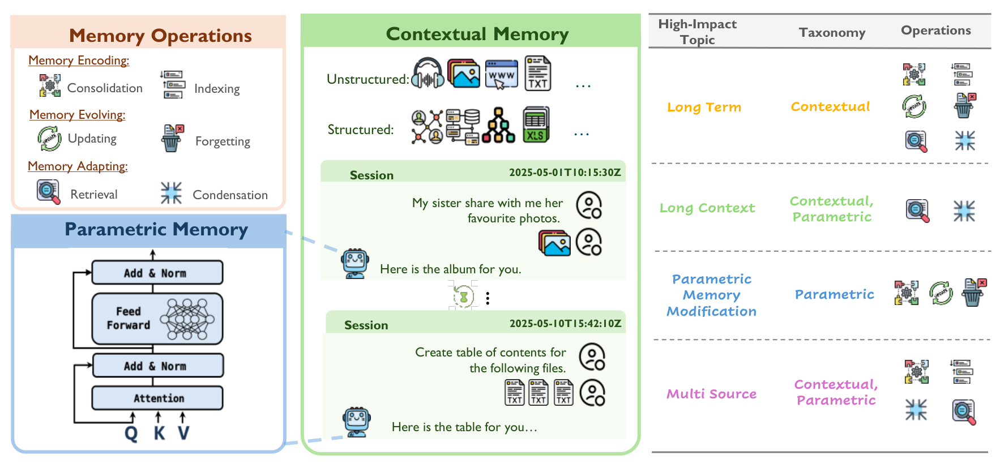

# 记忆综述 · 表示、六类操作与研究主题总览

<!-- CATEGORY NAV -->
[Teaser](../README.md) · [Architecture](../../architecture/README.md) · [Element](../../element/README.md) · [总目录](../../CATALOG.md)
<!-- END CATEGORY NAV -->

**Teaser · 原论文 Figure 1 · 2505.00675v3**

## 内容与构图

左侧操作与 Transformer 参数结构，中间上下文记忆及两个会话例子，右侧把四个研究主题映射到记忆类型与操作，兼有概念、例子和对应关系。

左侧六类操作和参数记忆，中央上下文记忆与两例会话，右侧四主题映射表。

概念、方法差异或能力的总览，按主要表达用途归入 Teaser。

原图中的分类、时间戳与例子属于所收录的 2025 年 arXiv v3；本次只收集图形参考，不把历史分类改为永久选图标准。

## 与这次四张参考图的关系

沿 [参考图 4 · Cortex](../../teaser/cortex-memory-consolidation/README.md) · [参考图 2 · Speculative RAG](../../architecture/speculative-rag-draft-verify/README.md) · [参考图 3 · MemoryVLA](../../teaser/memoryvla-cognition-memory-action/README.md) 的表达方式继续检索。

可借鉴的组织关系：

- 操作符号在图例与主题映射中复用。
- 抽象分类中嵌入具体会话，让研究主题有对象可指。

## 文件与编辑范围

[作者独立 PDF](original.pdf) · [SVG 转换件](source.svg) · [原始插图定义](figure-inclusion.tex) · [来源与校验记录](metadata.json)

作者独立 PDF 含 24 个绘图对象、43 个文本片段和 41 个嵌入位图对象；保留原有矢量、文字或轮廓。SVG 是 PDF 转换件，文字转轮廓，嵌入图片保持。位图对象数不代表子图数。

PDF 的框线、箭头和原有文字对象或轮廓可按实际对象修改；照片和部分图标仍为位图。桌面 Illustrator 尚未逐项实测。

## 原始出处

- 论文：[Rethinking Memory in LLM based Agents: Representations, Operations, and Emerging Topics](https://arxiv.org/abs/2505.00675v3)
- 作者：Du, Yiming；Huang, Wenyu；Zheng, Danna；Wang, Zhaowei；Montella, Sebastien；Lapata, Mirella；Wong, Kam-Fai；Pan, Jeff Z.
- [作者项目或仓库](https://github.com/Elvin-Yiming-Du/Survey_Memory_in_AI)
- 所收录版本：`2505.00675v3`，原文 PDF 第 4 页，Figure 1。
- [固定版本 TeX 源码归档](https://arxiv.org/src/2505.00675v3)；原件路径 `figures_new/framework_1018.pdf`。

## 权利与转换记录

所收录 arXiv 版本声明 CC0 1.0；保留论文、作者与版本出处。图中第三方素材及商标不因该声明自动改变权利状态。

[原版本许可](https://creativecommons.org/publicdomain/zero/1.0/) · [权利记录](RIGHTS.source.txt)

原始文件按原字节保存，转换件另存。

<!-- BEGIN FIGURE LINKS -->
## 关联范例与元素

**可搭配的现有元素：** [数据库](../../element/svg/tabler-database.svg) · [网络](../../element/svg/tabler-network.svg) · [文本文件](../../element/svg/tabler-file-text.svg) · [回环箭头](../../element/svg/tabler-arrow-loop-right.svg)

这些元素按表达功能关联，并非从本论文原图拆出；来源和许可仍以各元素记录为准。

[范例与元素对照表](../../element/with-examples.md) · [元素分类目录](../../element/README.md)
<!-- END FIGURE LINKS -->
