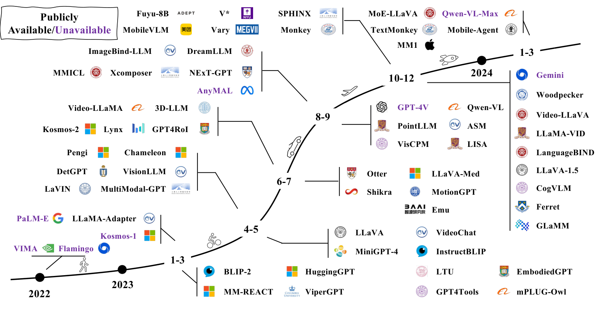

# 多模态大模型发展 · 分段曲线时间线

<!-- CATEGORY NAV -->
[Teaser](../README.md) · [Architecture](../../architecture/README.md) · [Element](../../element/README.md) · [总目录](../../CATALOG.md)
<!-- END CATEGORY NAV -->

[所属分类](../README.md) · [总目录](../../CATALOG.md)

**National Science Review 2024 · 期刊综述 · 原论文 Figure 1**

## 为什么收这张图

弯曲时间轴配合阶段分支和小型图标，在一张横向图内承载多模态模型从 2022 年到 2024 年初的发展；比普通表格更容易看出阶段。

综述 Figure 1 的时间线总览；适合领域背景页和发展脉络页，不是模型之间的架构连接关系。

## 可以借鉴

- 用稀疏主轴承载时间，把具体模型放在两侧分支。
- 模型标识与名称并列，少量颜色编码公开可用状态。
- 这是作者所收录时期的代表模型快照，原始布局与条目范围均保持不变。

## 文件与编辑范围

[作者原始 PDF](original.pdf) · [SVG 转换件](source.svg) · [原始 LaTeX 插图定义](figure-inclusion.tex) · [来源与校验记录](metadata.json)

作者独立 PDF 中的文字与图形对象保留；SVG 文字转为轮廓。原有照片、标识、人物或渲染仍为嵌入位图，可移动替换，不能按矢量节点编辑。

对照原论文页核实了图号和实际用途；独立 PDF 按作者提交的原文件保存。

原始 PDF 来自作者提交的 TeX 归档，未改字节；SVG 是格式转换件，未取得原生 AI 工程。桌面 Illustrator 尚未逐项实测。

## 原始出处

- 论文：[A Survey on Multimodal Large Language Models](https://arxiv.org/abs/2306.13549v4)
- 作者：Yin, Shukang, Fu, Chaoyou, Zhao, Sirui, Li, Ke, Sun, Xing, Xu, Tong, Chen, Enhong
- [作者项目或仓库](https://github.com/BradyFU/Awesome-Multimodal-Large-Language-Models)
- [论文 TeX 原始归档](https://arxiv.org/src/2306.13549v4)，固定版本 `2306.13549v4`。
- 归档内路径：`figs/survey-timeline.pdf`；原文 PDF 第 2 页，Figure 1。
- [出版与来源依据](https://arxiv.org/abs/2306.13549v4)；出版年份与所收录 arXiv 修订版时间分别记录。

## 权利与修改记录

所收录 arXiv 版本声明 CC BY 4.0；保留作者署名、原文链接和格式转换说明。图中的第三方照片、标识、模型渲染与引用素材仍需按其原权利声明使用。

[原文许可声明](https://creativecommons.org/licenses/by/4.0/) · [本条权利记录](RIGHTS.source.txt)

只复制作者原件、转换格式和制作预览；没有重绘或新增图形。

<!-- BEGIN FIGURE LINKS -->
## 关联范例与元素

同论文的其他图：[MLLM 统一架构 · 模态接口与连接器对照](../../architecture/survey-mllm-connector-framework/README.md)

**可搭配的现有元素：** [路径](../../element/svg/tabler-route.svg) · [图像](../../element/svg/tabler-photo.svg) · [文本文件](../../element/svg/tabler-file-text.svg) · [时钟](../../element/svg/tabler-clock.svg)

这些元素按表达功能关联，并非从本论文原图拆出；来源和许可仍以各元素记录为准。

[范例与元素对照表](../../element/with-examples.md) · [元素分类目录](../../element/README.md)
<!-- END FIGURE LINKS -->
