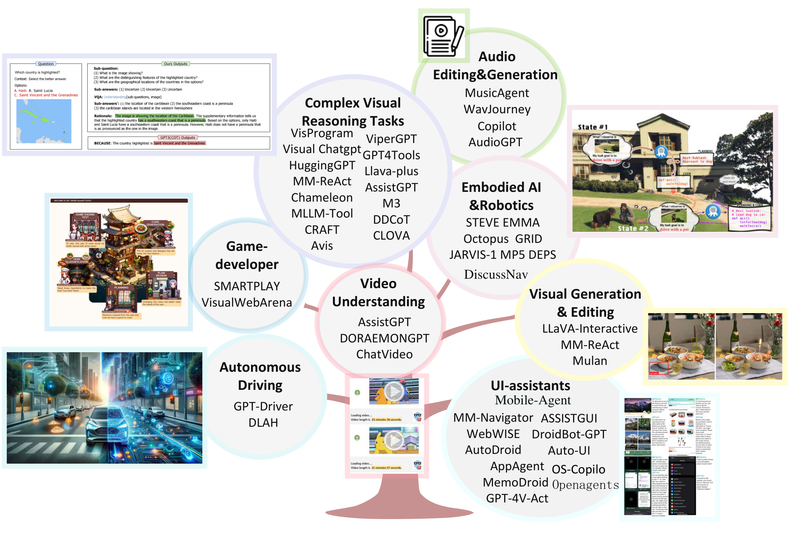

# 多模态 Agent · 8 类应用与外围场景子图

<!-- CATEGORY NAV -->
[Teaser](../README.md) · [Architecture](../../architecture/README.md) · [Element](../../element/README.md) · [总目录](../../CATALOG.md)
<!-- END CATEGORY NAV -->

[所属分类](../README.md) · [总目录](../../CATALOG.md)

**arXiv 2024 · 综述 · 原论文 Figure 4**

## 子图组织

8 个应用主题，外围配置代表性场景或交互截图。

按 8 个有名称的应用主题计数；截图中的多个界面窗口不额外计作独立应用子图。

## 为什么收这张图

8 类应用围绕中心展开，外围场景图分别对应 UI 助手、驾驶、游戏、机器人、音视频和视觉推理等主题；既有领域分类，也有能直接识别的任务实例。

综述 Figure 4 的应用全景参考，原文并非首图。适合借鉴中心分类与外围场景相互对应的多子图构图。

## 可以借鉴

- 主题名称放在中心附近，具体截图放到外侧，让抽象与具体两层对应。
- 采用不同的轻色轮廓区分应用，保持场景照片本身的颜色。
- 代表方法名称是作者所收录版本的范围，改编时应更新并核对。

## 文件与编辑范围

[作者原始 PDF](original.pdf) · [SVG 转换件](source.svg) · [原始插图定义](figure-inclusion.tex) · [来源与校验记录](metadata.json)

独立 PDF 保留作者原有图形和文本对象；SVG 文字转轮廓。各照片与结果图仍是嵌入位图，可移动或替换，不能按矢量节点编辑。

原件来自作者固定版本源码归档；桌面 Illustrator 尚未逐项实测。

## 原始出处

- 论文：[Large Multimodal Agents: A Survey](https://arxiv.org/abs/2402.15116v1)
- 作者：Xie, Junlin；Chen, Zhihong；Zhang, Ruifei；Wan, Xiang；Li, Guanbin
- [作者项目或原文](https://github.com/jun0wanan/awesome-large-multimodal-agents)
- [作者 TeX 源码归档](https://arxiv.org/src/2402.15116v1)；版本 `2402.15116v1`。
- 归档内路径：`figures/app.pdf`。原文 PDF 第 9 页，Figure 4。

## 权利与修改记录

所收录版本声明 CC BY 4.0；保留作者署名、原文链接与转换记录。 子图引用的第三方照片、截图、生成结果与原论文图例仍按其原始权利声明使用。

[原文许可声明](https://creativecommons.org/licenses/by/4.0/) · [权利记录](RIGHTS.source.txt)

只复制原件、转换格式和制作预览；所有内容沿用作者原图。

<!-- BEGIN FIGURE LINKS -->
## 关联范例与元素

**可搭配的现有元素：** [机器人](../../element/svg/tabler-robot.svg) · [视频](../../element/svg/tabler-video.svg) · [对话](../../element/svg/tabler-message.svg) · [图像](../../element/svg/tabler-photo.svg) · [网络](../../element/svg/tabler-network.svg)

这些元素按表达功能关联，并非从本论文原图拆出；来源和许可仍以各元素记录为准。

[范例与元素对照表](../../element/with-examples.md) · [元素分类目录](../../element/README.md)
<!-- END FIGURE LINKS -->
