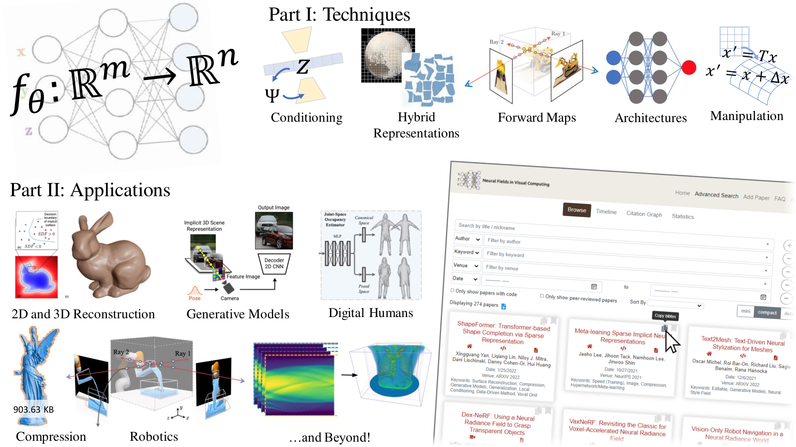

# Neural Fields · 5 类技术与 6 类应用的多子图 teaser

<!-- CATEGORY NAV -->
[Teaser](../README.md) · [Architecture](../../architecture/README.md) · [Element](../../element/README.md) · [总目录](../../CATALOG.md)
<!-- END CATEGORY NAV -->

[所属分类](../README.md) · [总目录](../../CATALOG.md)

**EUROGRAPHICS 2022 · 综述 · 原论文 Figure 1**

## 子图组织

上层 5 类技术，下层 6 类应用，另有数据库预览。

技术标签计 5 类，应用标签计 6 类；左侧场函数符号与右侧数据库截图不计入 11 个主题子图。

## 为什么收这张图

把 5 类通用技术放在上层、6 类应用放在下层，再用一个数据库截图连接到综述资源；每个主题有短标签、不同形态的原论文图例和清楚分区，是完整的综述首图。

原论文 Figure 1 的核心 teaser 画面。独立 PDF 未包括由 LaTeX 另叠加的顶部网页链接；对应插图定义一并保留。

## 可以借鉴

- 技术与应用用两条主线分层，子图在同层采用相近视觉尺度。
- 用几何、物理场、数字人体、机器人等视觉对象表达领域范围。
- 右侧资源预览作为辅助区，不挤占主要主题子图；作者的 PowerPoint 组成源文件另存原样归档。

## 文件与编辑范围

[作者原始 PDF](original.pdf) · [SVG 转换件](source.svg) · [原始插图定义](figure-inclusion.tex) · [来源与校验记录](metadata.json)

独立 PDF 保留作者原有图形和文本对象；SVG 文字转轮廓。各照片与结果图仍是嵌入位图，可移动或替换，不能按矢量节点编辑。

[作者 PowerPoint 组成源文件](author-office-parts.zip) · [逐文件来源清单](author-office-parts.json)

作者归档包含两张幻灯片的 OOXML 组成文件，均保留原字节。此 ZIP 是原始组成文件包，未修复为可直接打开的 PPTX；第二张源幻灯片与所收录 PDF 的 Conditioning 标签对应。

原件来自作者固定版本源码归档；桌面 Illustrator 尚未逐项实测。

## 原始出处

- 论文：[Neural Fields in Visual Computing and Beyond](https://arxiv.org/abs/2111.11426v4)
- 作者：Xie, Yiheng；Takikawa, Towaki；Saito, Shunsuke；Litany, Or；Yan, Shiqin；Khan, Numair；Tombari, Federico；Tompkin, James；Sitzmann, Vincent；Sridhar, Srinath
- [作者项目或原文](https://neuralfields.cs.brown.edu/)
- [作者 TeX 源码归档](https://arxiv.org/src/2111.11426v4)；版本 `2111.11426v4`。
- 归档内路径：`figures/teaser/NeuralFieldsReview_Teaser.pdf`。原文 PDF 第 1 页，Figure 1。

## 权利与修改记录

所收录版本的 arXiv 非独占分发许可不是第三方图形重用许可；此条用于个人私有参考，公开改编或再用需核对原权利。 子图引用的第三方照片、截图、生成结果与原论文图例仍按其原始权利声明使用。

[原文许可声明](https://arxiv.org/licenses/nonexclusive-distrib/1.0/) · [权利记录](RIGHTS.source.txt)

只复制原件、转换格式和制作预览；所有内容沿用作者原图。

<!-- BEGIN FIGURE LINKS -->
## 关联范例与元素

**可搭配的现有元素：** [浅层神经网络](../../element/svg/towaki-neuralnetwork.svg) · [相机](../../element/svg/tabler-camera.svg) · [三维坐标物体](../../element/svg/tabler-cube-3d-sphere.svg) · [机器人](../../element/svg/tabler-robot.svg) · [数据库](../../element/svg/tabler-database.svg)

这些元素按表达功能关联，并非从本论文原图拆出；来源和许可仍以各元素记录为准。

[范例与元素对照表](../../element/with-examples.md) · [元素分类目录](../../element/README.md)
<!-- END FIGURE LINKS -->
