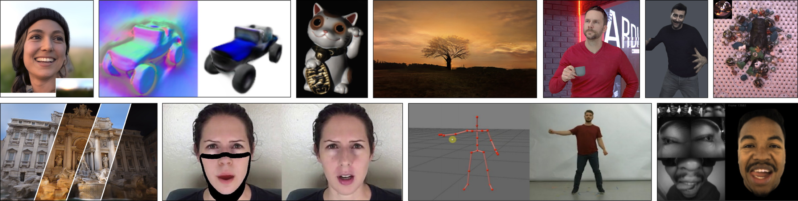

# Neural Rendering 2020 · 两排 11 组场景 teaser

<!-- CATEGORY NAV -->
[Teaser](../README.md) · [Architecture](../../architecture/README.md) · [Element](../../element/README.md) · [总目录](../../CATALOG.md)
<!-- END CATEGORY NAV -->

[所属分类](../README.md) · [总目录](../../CATALOG.md)

**EUROGRAPHICS 2020 · 综述 · 原论文 Figure 1**

## 子图组织

两排 11 组场景示例，组内可包含多个视图或输入输出对。

按原图边框与留白分为上排 7 组、下排 4 组。作者未用 (a)–(k) 编号；这不是图片总张数。

## 为什么收这张图

两排 11 组场景覆盖人像、对象、场景、重光照、表情与人体驱动，使用不同宽度的小组安排输入输出对和多视角样例，整张图仍保持平齐的上下边界。

综述原论文 Figure 1，作者在 TeX 中明确作为 teaser 使用。原件为整张 JPEG，此条作为布局与内容组织参考。

## 可以借鉴

- 行高统一、组宽可变，让成对比较和宽场景都有合适空间。
- 使用细边框和小留白分组，减少解释性文字。
- 整张 JPEG 的照片和边框已合并，逐个子图需裁切后替换，不能当作矢量画板。

## 文件与编辑范围

[作者原始 JPEG](source.jpg) · [原始插图定义](figure-inclusion.tex) · [来源与校验记录](metadata.json)

作者原件是一张完整 JPEG，所有子图已合并；此条为构图与场景组织参考。保留原字节，不提供伪矢量 SVG。

原件来自作者固定版本源码归档；桌面 Illustrator 尚未逐项实测。

## 原始出处

- 论文：[State of the Art on Neural Rendering](https://arxiv.org/abs/2004.03805v1)
- 作者：Tewari, Ayush；Fried, Ohad；Thies, Justus；Sitzmann, Vincent；Lombardi, Stephen；Sunkavalli, Kalyan；Martin-Brualla, Ricardo；Simon, Tomas；Saragih, Jason；Nießner, Matthias；Pandey, Rohit；Fanello, Sean；Wetzstein, Gordon；Zhu, Jun-Yan；Theobalt, Christian；Agrawala, Maneesh；Shechtman, Eli；Goldman, Dan B；Zollhöfer, Michael
- [作者项目或原文](https://arxiv.org/abs/2004.03805)
- [作者 TeX 源码归档](https://arxiv.org/src/2004.03805v1)；版本 `2004.03805v1`。
- 归档内路径：`applications/images_lq/teaser2.jpg`。原文 PDF 第 1 页，Figure 1。

## 权利与修改记录

所收录版本的 arXiv 非独占分发许可不是第三方图形重用许可；此条用于个人私有参考，公开改编或再用需核对原权利。 子图引用的第三方照片、截图、生成结果与原论文图例仍按其原始权利声明使用。

[原文许可声明](https://arxiv.org/licenses/nonexclusive-distrib/1.0/) · [权利记录](RIGHTS.source.txt)

只复制原件、转换格式和制作预览；所有内容沿用作者原图。

<!-- BEGIN FIGURE LINKS -->
## 关联范例与元素

**可搭配的现有元素：** [相机](../../element/svg/tabler-camera.svg) · [图像](../../element/svg/tabler-photo.svg) · [多用户](../../element/svg/tabler-users.svg) · [三维坐标物体](../../element/svg/tabler-cube-3d-sphere.svg)

这些元素按表达功能关联，并非从本论文原图拆出；来源和许可仍以各元素记录为准。

[范例与元素对照表](../../element/with-examples.md) · [元素分类目录](../../element/README.md)
<!-- END FIGURE LINKS -->
