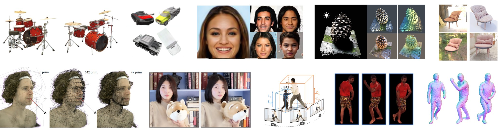

# Advances in Neural Rendering · 两排约 10 组主题 teaser

<!-- CATEGORY NAV -->
[Teaser](../README.md) · [Architecture](../../architecture/README.md) · [Element](../../element/README.md) · [总目录](../../CATALOG.md)
<!-- END CATEGORY NAV -->

[所属分类](../README.md) · [总目录](../../CATALOG.md)

**EUROGRAPHICS 2022 · 综述 · 原论文 Figure 1**

## 子图组织

两排约 10 个主题组，每组用多个视图或状态展示一种能力。

按留白与主题分为上排 5 组、下排 5 组；原图未给这些组编号，组内的多个人脸、椅子、视图或时刻不另计主题。

## 为什么收这张图

把自由视角、生成、重光照、场景编辑和动态人物等能力排成两层图群；组内用多个视图或状态形成小叙事，既展示多样性，也让同一能力的变化可见。

综述原论文 Figure 1，TeX 中的 teaser 原件。源文件为整张 JPEG，明确作为多子图构图参考收录。

## 可以借鉴

- 每组用同一种对象讲一个能力变化，例如多视角、不同光照或连续动作。
- 组间用留白分隔，维持两排的整体秩序。
- 图注承担方法出处，画面主要用于展示主题范围；组内样例不是统一基准评测。

## 文件与编辑范围

[作者原始 JPEG](source.jpg) · [原始插图定义](figure-inclusion.tex) · [来源与校验记录](metadata.json)

作者原件是一张完整 JPEG，所有子图已合并；此条为构图与场景组织参考。保留原字节，不提供伪矢量 SVG。

原件来自作者固定版本源码归档；桌面 Illustrator 尚未逐项实测。

## 原始出处

- 论文：[Advances in Neural Rendering](https://arxiv.org/abs/2111.05849v2)
- 作者：Tewari, Ayush；Thies, Justus；Mildenhall, Ben；Srinivasan, Pratul；Tretschk, Edgar；Wang, Yifan；Lassner, Christoph；Sitzmann, Vincent；Martin-Brualla, Ricardo；Lombardi, Stephen；Simon, Tomas；Theobalt, Christian；Niessner, Matthias；Barron, Jonathan T.；Wetzstein, Gordon；Zollhoefer, Michael；Golyanik, Vladislav
- [作者项目或原文](https://arxiv.org/abs/2111.05849)
- [作者 TeX 源码归档](https://arxiv.org/src/2111.05849v2)；版本 `2111.05849v2`。
- 归档内路径：`figures/teaser.jpg`。原文 PDF 第 1 页，Figure 1。

## 权利与修改记录

所收录版本的 arXiv 非独占分发许可不是第三方图形重用许可；此条用于个人私有参考，公开改编或再用需核对原权利。 子图引用的第三方照片、截图、生成结果与原论文图例仍按其原始权利声明使用。

[原文许可声明](https://arxiv.org/licenses/nonexclusive-distrib/1.0/) · [权利记录](RIGHTS.source.txt)

只复制原件、转换格式和制作预览；所有内容沿用作者原图。

<!-- BEGIN FIGURE LINKS -->
## 关联范例与元素

**可搭配的现有元素：** [相机](../../element/svg/tabler-camera.svg) · [图像](../../element/svg/tabler-photo.svg) · [视频](../../element/svg/tabler-video.svg) · [多用户](../../element/svg/tabler-users.svg) · [时钟](../../element/svg/tabler-clock.svg)

这些元素按表达功能关联，并非从本论文原图拆出；来源和许可仍以各元素记录为准。

[范例与元素对照表](../../element/with-examples.md) · [元素分类目录](../../element/README.md)
<!-- END FIGURE LINKS -->
