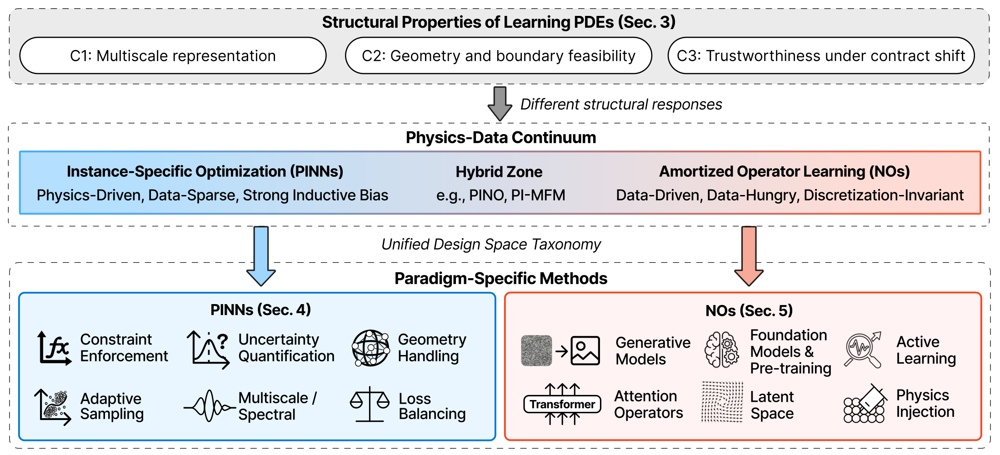

# PDE 求解综述 · 物理—数据连续谱与两类方法全景

<!-- CATEGORY NAV -->
[Teaser](../README.md) · [Architecture](../../architecture/README.md) · [Element](../../element/README.md) · [总目录](../../CATALOG.md)
<!-- END CATEGORY NAV -->

[所属分类](../README.md) · [总目录](../../CATALOG.md)

**IJCAI 2026 · 综述 · 原论文 Figure 1**

## 子图组织

上层 3 个共同问题，中层物理—数据连续谱，下层两类方法各 6 个研究方向。

下层按 12 个图标与标签组合计研究主题；中间 Hybrid Zone 是融合区域，不单独计作第三套完整方法面板。

## 为什么收这张图

共同难题、统一视角和分支方法排成三层。PINNs 与神经算子沿同一物理—数据主线对照，下层用 12 个小型科学／方法图示解释具体研究方向，信息丰富且阅读顺序清楚。

综述 Figure 1，采用所收录 arXiv v2 中的作者原图；会议与图版本分别记录。与 AI4PDE Fig.2 同样以物理和数据的关系组织方法对照。

## 相近表达

都将物理与数据的关系作为组织主线，再用具体方法内容解释不同分支。 对照查看：[AI4PDE 综述范例](../survey-ai-pde-physics-data-paradigms/README.md)。

## 可以借鉴

- 先展示共同问题，再给出统一分类视角，最后展开各分支的代表方向。
- 用一致的行高和图标尺度容纳多项研究内容。
- 渐变条承载连续谱的概念，分色区域承载两类方法的差异。

## 可美化的方向（尚未改绘）

- 改编时可保留三层结构，减少章节号和不必要的标题重复。
- 长标签可压缩为统一长度的短语，但应保持每个研究方向的含义。

## 文件与编辑范围

[作者原始 PDF](original.pdf) · [SVG 转换件](source.svg) · [原始插图定义](figure-inclusion.tex) · [来源与校验记录](metadata.json)

独立 PDF 保留作者原有图形和文本对象；SVG 文字转轮廓。原图中的嵌入位图可移动或替换，不能按矢量节点编辑。

原件来自作者固定版本源码归档；桌面 Illustrator 尚未逐项实测。

## 原始出处

- 论文：[Learning PDE Solvers with Physics and Data: A Unifying View of Physics-Informed Neural Networks and Neural Operators](https://arxiv.org/abs/2601.14517v2)
- 作者：Dai, Yilong；Chen, Shengyu；Wang, Ziyi；Jia, Xiaowei；Xie, Yiqun；Kumar, Vipin；Yu, Runlong
- [作者项目或原文](https://ijcai.org/proceedings/2026/868)
- [作者 TeX 源码归档](https://arxiv.org/src/2601.14517v2)；版本 `2601.14517v2`。
- 归档内路径：`figure1.pdf`。原文 PDF 第 3 页，Figure 1。

## 权利与修改记录

所收录版本声明 CC BY 4.0；保留作者署名、原文链接与转换记录。 子图引用的第三方照片、截图、生成结果与原论文图例仍按其原始权利声明使用。

[原文许可声明](https://creativecommons.org/licenses/by/4.0/) · [权利记录](RIGHTS.source.txt)

只复制原件、转换格式和制作预览；所有内容沿用作者原图。

<!-- BEGIN FIGURE LINKS -->
## 关联范例与元素

**可搭配的现有元素：** [网络](../../element/svg/tabler-network.svg) · [大脑](../../element/svg/tabler-brain.svg) · [正弦信号](../../element/svg/tabler-wave-sine.svg) · [数据库](../../element/svg/tabler-database.svg) · [水平双向箭头](../../element/svg/tabler-arrows-right-left.svg)

这些元素按表达功能关联，并非从本论文原图拆出；来源和许可仍以各元素记录为准。

[范例与元素对照表](../../element/with-examples.md) · [元素分类目录](../../element/README.md)
<!-- END FIGURE LINKS -->
