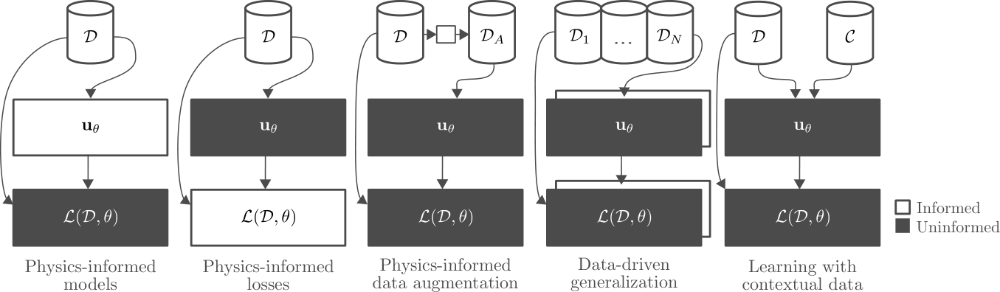

# 物理知识融入学习 · 五种方式的统一图元对照

<!-- CATEGORY NAV -->
[Teaser](../README.md) · [Architecture](../../architecture/README.md) · [Element](../../element/README.md) · [总目录](../../CATALOG.md)
<!-- END CATEGORY NAV -->

[所属分类](../README.md) · [总目录](../../CATALOG.md)

**TMLR 2025 · 综述 · 原论文 Figure 1**

## 子图组织

五栏并列：物理模型、物理损失、物理数据增强、多数据集泛化和上下文学习。

按下方五个范式标签计数；白色／深色框表示作者定义的 informed／uninformed，属于概念编码，不是性能评分。

## 为什么收这张图

五栏使用同一套数据、模型和目标函数图元，通过信息流和明暗编码突出物理知识进入学习过程的位置。读者只需理解一栏的图示规则，就能比较其余四栏。

综述 Figure 1。与 AI4PDE Fig.2 相近之处是固定一套可比较的条件与图元，再展示多种方法范式。

## 相近表达

以相同图元对照物理知识进入学习过程的不同方式。 对照查看：[AI4PDE 综述范例](../survey-ai-pde-physics-data-paradigms/README.md)。

## 可以借鉴

- 同一对象在所有面板中保持相同符号和位置。
- 以局部结构变化表达方法区别，避免每栏重新设计一套图例。
- 图例集中放在一处，底部短标签概括每种方式。

## 可美化的方向（尚未改绘）

- 改编时可用少量强调色替换明暗编码，并保留清楚的图例。
- 统一各栏的宽度、模型框高度与箭头路径。

## 文件与编辑范围

[作者原始 PDF](original.pdf) · [SVG 转换件](source.svg) · [原始插图定义](figure-inclusion.tex) · [来源与校验记录](metadata.json)

独立 PDF 保留作者原有矢量图形、连线和文本对象；SVG 文字转轮廓。此独立 PDF 未检测到嵌入位图。

[作者原生 SVG](author-source.svg)

作者原生 SVG 保留原字节及原有文字对象；部分文字仍为轮廓。`source.svg` 是由论文实际使用的 PDF 转换、供稳定显示的版本。

作者原生 SVG 的画布留白较大，部分字体和布局与论文 PDF 略有差异；需要论文中的紧凑版式时使用 original.pdf 或 source.svg。

原件来自作者固定版本源码归档；桌面 Illustrator 尚未逐项实测。

## 原始出处

- 论文：[Machine Learning with Physics Knowledge for Prediction: A Survey](https://arxiv.org/abs/2408.09840v2)
- 作者：Watson, Joe；Song, Chen；Weeger, Oliver；Gruner, Theo；Le, An T.；Pompetzki, Kay；Hendawy, Ahmed；Arenz, Oleg；Trojak, Will；Cranmer, Miles；D'Eramo, Carlo；Bülow, Fabian；Goyal, Tanmay；Peters, Jan；Hoffman, Martin W.
- [作者项目或原文](https://arxiv.org/abs/2408.09840)
- [作者 TeX 源码归档](https://arxiv.org/src/2408.09840v2)；版本 `2408.09840v2`。
- 归档内路径：`figures/overview-rebuttal.pdf`。原文 PDF 第 3 页，Figure 1。

## 权利与修改记录

所收录版本的 arXiv 非独占分发许可不是第三方图形重用许可；此条用于个人私有参考，公开改编或再用需核对原权利。 子图引用的第三方照片、截图、生成结果与原论文图例仍按其原始权利声明使用。

[原文许可声明](https://arxiv.org/licenses/nonexclusive-distrib/1.0/) · [权利记录](RIGHTS.source.txt)

只复制原件、转换格式和制作预览；所有内容沿用作者原图。

<!-- BEGIN FIGURE LINKS -->
## 关联范例与元素

**可搭配的现有元素：** [数据库](../../element/svg/tabler-database.svg) · [浅层神经网络](../../element/svg/towaki-neuralnetwork.svg) · [水平双向箭头](../../element/svg/tabler-arrows-right-left.svg) · [文本文件](../../element/svg/tabler-file-text.svg)

这些元素按表达功能关联，并非从本论文原图拆出；来源和许可仍以各元素记录为准。

[范例与元素对照表](../../element/with-examples.md) · [元素分类目录](../../element/README.md)
<!-- END FIGURE LINKS -->
