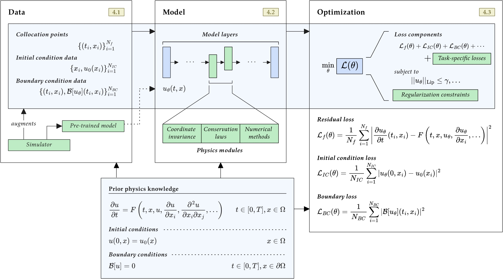

# PIML · 数据、模型与优化的完整融合流程

<!-- CATEGORY NAV -->
[Teaser](../README.md) · [Architecture](../../architecture/README.md) · [Element](../../element/README.md) · [总目录](../../CATALOG.md)
<!-- END CATEGORY NAV -->

[Teaser](../README.md) · [Architecture](../../architecture/README.md) · [Element](../../element/README.md) · [总目录](../../CATALOG.md)

**整图位图，仅构图参考。**

## 内容与构图

三个并列区域分别展开数据、模型与优化；底部共享物理先验向三处提供约束，框内保留采样点、物理模块和损失方程。适合借鉴为内容充实的综述概念总览。

期刊综述 Figure 2，出版商 PDF 第 12 页。此图来自 2025 年期刊版本，作为融合流程的构图参考。

三列流程＋底部共享物理先验；蓝色区域贯穿数据、模型和优化三列。

## 可以借鉴

- 用同一物理先验连接多种融入位置。
- 各列保持统一阅读结构，又用公式和模块说明具体内容。
- 区分贯穿整图的主流程与局部方法展开。

## 文件与编辑范围

[作者／出版商原始图片](source.png) · [来源与校验记录](metadata.json)

所有图元与文字已合并；保留原始 PNG／JPEG，不将其包装成可编辑 SVG。

## 相近表达

[AI4PDE 综述范例](../survey-ai-pde-physics-data-paradigms/README.md)

## 原始出处

- [作者／出版商来源页面](https://link.springer.com/article/10.1007/s44379-025-00016-0)
- [固定版本或原图下载](https://media.springernature.com/full/springer-static/image/art%3A10.1007%2Fs44379-025-00016-0/MediaObjects/44379_2025_16_Fig2_HTML.png)
- 作者：Chuizheng Meng；Sam Griesemer；Defu Cao；Sungyong Seo；Yan Liu

## 权利与修改记录

出版商原文声明 CC BY 4.0。保留作者、期刊版本、原图链接和修改记录；第三方素材按其原声明。

[权利记录](RIGHTS.source.txt)

<!-- BEGIN FIGURE LINKS -->
## 关联范例与元素

**可搭配的现有元素：** [数据库](../../element/svg/tabler-database.svg) · [浅层神经网络](../../element/svg/towaki-neuralnetwork.svg) · [文本文件](../../element/svg/tabler-file-text.svg) · [右箭头](../../element/svg/tabler-arrow-right.svg)

这些元素按表达功能关联，并非从本论文原图拆出；来源和许可仍以各元素记录为准。

[范例与元素对照表](../../element/with-examples.md) · [元素分类目录](../../element/README.md)
<!-- END FIGURE LINKS -->
