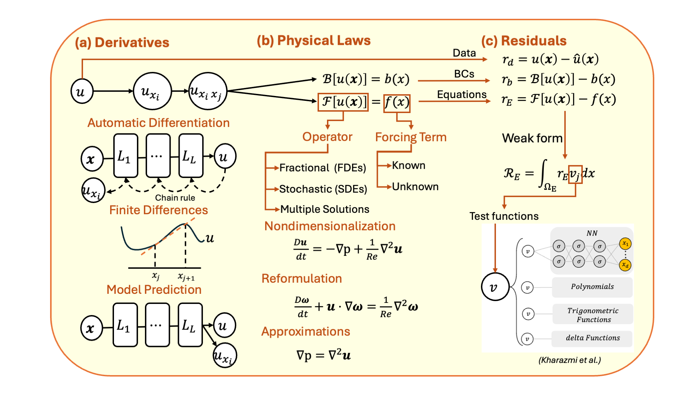

# PINN 综述 · 导数、物理方程与残差三栏展开

<!-- CATEGORY NAV -->
[Teaser](../README.md) · [Architecture](../../architecture/README.md) · [Element](../../element/README.md) · [总目录](../../CATALOG.md)
<!-- END CATEGORY NAV -->

[Teaser](../README.md) · [Architecture](../../architecture/README.md) · [Element](../../element/README.md) · [总目录](../../CATALOG.md)

**arXiv 2024 · Figure 4**

## 内容与组织

以导数、物理规律和残差为三条主线，将自动微分、有限差分、不同算子、无量纲化、方程改写与弱形式整合到一个有公式和科学示意的总览里。

三个带 (a)–(c) 标记的主题区：导数求取、物理规律、强形式／弱形式残差。

按三个主题区计面板；自动微分网络、有限差分曲线、无量纲化方程和测试函数是区内的说明图元。

综述预印本 Figure 4，PDF 第 14 页，原文并非首图。适合参考其多栏目组织方法，把若干技术方向解释成一张概念总览。

## 可以借鉴

- 每栏先给主要关系，再向下展开代表性的技术分支。
- 直接用曲线、方程和网络说明差异，避免只列分类名。
- 用跨栏箭头保留导数、物理关系与残差之间的联系。

## 文件与编辑范围

[作者原始 PNG](source.png) · [来源与校验记录](metadata.json) · [原始插图定义](figure-inclusion.tex)

作者原件是一张完整 PNG（2000 × 1136）；文字与子图已经合并。本条保留原始图片作构图参考，不提供伪矢量 SVG。

## 相近范例

[AI4PDE 综述范例](../survey-ai-pde-physics-data-paradigms/README.md)

## 原始出处

- 文章：[From PINNs to PIKANs: Recent Advances in Physics-Informed Machine Learning](https://arxiv.org/abs/2410.13228v2)
- 作者：Toscano, Juan Diego；Oommen, Vivek；Varghese, Alan John；Zou, Zongren；Daryakenari, Nazanin Ahmadi；Wu, Chenxi；Karniadakis, George Em
- [来源页面](https://arxiv.org/abs/2410.13228)
- 版本：`2410.13228v2`；[作者源码归档](https://arxiv.org/src/2410.13228v2)；原图路径 `Images/GEq.png`。
- 原文 PDF 第 14 页，Figure 4。
- [2025 年期刊记录](https://link.springer.com/article/10.1007/s44379-025-00015-1)。本条图号、字节和许可均对应上述 arXiv 版本。

## 权利与修改记录

所收录版本声明 CC-BY-NC-SA-4.0。保留作者署名、固定版本和原许可链接；第三方子图按其原始权利声明。 所收录的是 2024 年 arXiv 固定版本；2025 年期刊版本另附链接，不混用其许可或图号。

[原文许可](https://creativecommons.org/licenses/by-nc-sa/4.0/) · [权利记录](RIGHTS.source.txt)

只复制原件、转换显示格式和制作预览；未重绘。

<!-- BEGIN FIGURE LINKS -->
## 关联范例与元素

同论文的其他图：[PINN 综述 · 问题、损失与优化的多子图全景](../survey-piml-optimization-landscape/README.md)

**可搭配的现有元素：** [正弦信号](../../element/svg/tabler-wave-sine.svg) · [浅层神经网络](../../element/svg/towaki-neuralnetwork.svg) · [右箭头](../../element/svg/tabler-arrow-right.svg) · [文本文件](../../element/svg/tabler-file-text.svg)

这些元素按表达功能关联，并非从本论文原图拆出；来源和许可仍以各元素记录为准。

[范例与元素对照表](../../element/with-examples.md) · [元素分类目录](../../element/README.md)
<!-- END FIGURE LINKS -->
