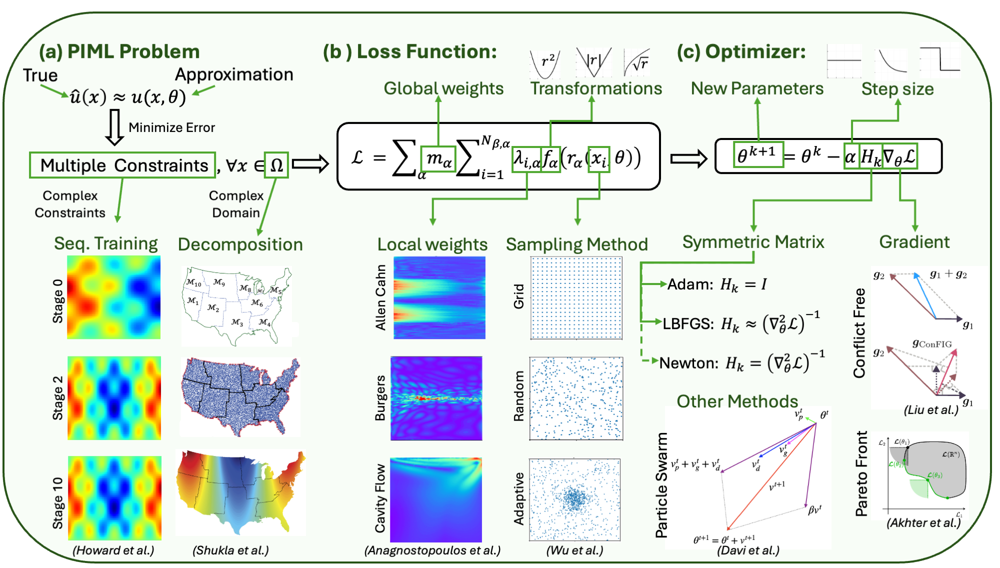

# PINN 综述 · 问题、损失与优化的多子图全景

<!-- CATEGORY NAV -->
[Teaser](../README.md) · [Architecture](../../architecture/README.md) · [Element](../../element/README.md) · [总目录](../../CATALOG.md)
<!-- END CATEGORY NAV -->

[Teaser](../README.md) · [Architecture](../../architecture/README.md) · [Element](../../element/README.md) · [总目录](../../CATALOG.md)

**arXiv 2024 · Figure 5**

## 内容与组织

上方主线串联问题、损失函数和优化器，下面用场分布、区域划分、采样点、梯度几何与 Pareto 前沿展开细节。是一张内容密度高、科学子图丰富的综述总览。

三大区：PIML 问题、损失函数、优化器；各区下面并列多个场分布、区域划分、采样和几何子示意。

按 (a)–(c) 三个主题区计主面板。各组内部小图数量不同，不把每个公式、地图或采样点单独计作方法类别。

综述预印本 Figure 5，PDF 第 18 页，原文并非首图。整图说明训练过程中的改进位置及方法家族，归入 Teaser 构图参考。

## 可以借鉴

- 主线放在上方，技术细节在对应位置向下展开。
- 为公式中的关键项加颜色，并连接到具体可视化示例。
- 多组小图采用对齐的行列，同时保留统一的外围主题区。

## 文件与编辑范围

[作者原始 PNG](source.png) · [来源与校验记录](metadata.json) · [原始插图定义](figure-inclusion.tex)

作者原件是一张完整 PNG（2000 × 1136）；文字与子图已经合并。本条保留原始图片作构图参考，不提供伪矢量 SVG。

## 相近范例

[AI4PDE 综述范例](../survey-ai-pde-scope-map/README.md)

## 原始出处

- 文章：[From PINNs to PIKANs: Recent Advances in Physics-Informed Machine Learning](https://arxiv.org/abs/2410.13228v2)
- 作者：Toscano, Juan Diego；Oommen, Vivek；Varghese, Alan John；Zou, Zongren；Daryakenari, Nazanin Ahmadi；Wu, Chenxi；Karniadakis, George Em
- [来源页面](https://arxiv.org/abs/2410.13228)
- 版本：`2410.13228v2`；[作者源码归档](https://arxiv.org/src/2410.13228v2)；原图路径 `Images/Optimization.png`。
- 原文 PDF 第 18 页，Figure 5。
- [2025 年期刊记录](https://link.springer.com/article/10.1007/s44379-025-00015-1)。本条图号、字节和许可均对应上述 arXiv 版本。

## 权利与修改记录

所收录版本声明 CC-BY-NC-SA-4.0。保留作者署名、固定版本和原许可链接；第三方子图按其原始权利声明。 所收录的是 2024 年 arXiv 固定版本；2025 年期刊版本另附链接，不混用其许可或图号。

[原文许可](https://creativecommons.org/licenses/by-nc-sa/4.0/) · [权利记录](RIGHTS.source.txt)

只复制原件、转换显示格式和制作预览；未重绘。

本条用于构图参考；具体算法定义与更新公式需按对应方法原论文核对。

<!-- BEGIN FIGURE LINKS -->
## 关联范例与元素

同论文的其他图：[PINN 综述 · 导数、物理方程与残差三栏展开](../survey-piml-equations-residuals/README.md)

**可搭配的现有元素：** [散点图符号](../../element/svg/tabler-chart-scatter.svg) · [右箭头](../../element/svg/tabler-arrow-right.svg) · [点阵](../../element/svg/tabler-grid-dots.svg) · [文本文件](../../element/svg/tabler-file-text.svg)

这些元素按表达功能关联，并非从本论文原图拆出；来源和许可仍以各元素记录为准。

[范例与元素对照表](../../element/with-examples.md) · [元素分类目录](../../element/README.md)
<!-- END FIGURE LINKS -->
