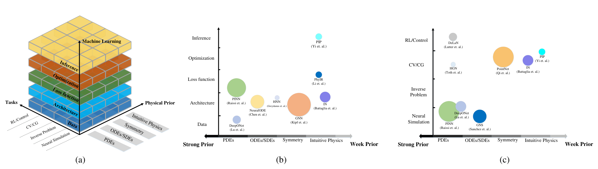

# PIML · 物理先验、融入层级与任务的三维全景

<!-- CATEGORY NAV -->
[Teaser](../README.md) · [Architecture](../../architecture/README.md) · [Element](../../element/README.md) · [总目录](../../CATALOG.md)
<!-- END CATEGORY NAV -->

[所属分类](../README.md) · [总目录](../../CATALOG.md)

**arXiv 2022 · 综述 · 原论文 Figure 1**

## 子图组织

(a) 三维分类示意；(b) 先验类型与融入层级；(c) 先验类型与应用任务。

按作者标出的 (a)–(c) 计三个面板。先验分 PDEs、ODEs/SDEs、Symmetry、Intuitive Physics；五个融入层级为数据、架构、损失、优化、推断。气泡与方法名称是该版本的示意性概览。

## 为什么收这张图

以物理先验、学习中的融入层级和任务为三个维度，再用两张二维图将代表方法放回同一分类空间。图形结构直接解释领域是如何被组织的。

综述 Figure 1。与 AI4PDE Fig.1 的领域—方法—应用总览相近，也可借鉴其统一维度下的方法定位。

## 相近表达

在同一全景中组织先验、方法与应用任务，形成有主线的综述概念图。 对照查看：[AI4PDE 综述范例](../survey-ai-pde-scope-map/README.md)。

## 可以借鉴

- 先用一个总图建立维度，再用展开视图放入具体方法。
- 三个子图复用相同的先验类型顺序。
- 区分方法定位、概念维度与定量数据，避免将概览误读为统一性能评测。

## 可美化的方向（尚未改绘）

- 改编时可放大轴标签，控制三维透视对文字可读性的影响。
- 减少无关的立体与阴影效果，将强调留给分类关系和代表方法。

## 文件与编辑范围

[作者原始 PDF](original.pdf) · [SVG 转换件](source.svg) · [原始插图定义](figure-inclusion.tex) · [来源与校验记录](metadata.json)

独立 PDF 保留作者原有图形和文本对象；SVG 文字转轮廓。原图中的嵌入位图可移动或替换，不能按矢量节点编辑。

原件来自作者固定版本源码归档；桌面 Illustrator 尚未逐项实测。

## 原始出处

- 论文：[Physics-Informed Machine Learning: A Survey on Problems, Methods and Applications](https://arxiv.org/abs/2211.08064v2)
- 作者：Hao, Zhongkai；Liu, Songming；Zhang, Yichi；Ying, Chengyang；Feng, Yao；Su, Hang；Zhu, Jun
- [作者项目或原文](https://arxiv.org/abs/2211.08064)
- [作者 TeX 源码归档](https://arxiv.org/src/2211.08064v2)；版本 `2211.08064v2`。
- 归档内路径：`fig/fig0_new.pdf`。原文 PDF 第 3 页，Figure 1。

## 权利与修改记录

所收录版本的 arXiv 非独占分发许可不是第三方图形重用许可；此条用于个人私有参考，公开改编或再用需核对原权利。 子图引用的第三方照片、截图、生成结果与原论文图例仍按其原始权利声明使用。

[原文许可声明](https://arxiv.org/licenses/nonexclusive-distrib/1.0/) · [权利记录](RIGHTS.source.txt)

只复制原件、转换格式和制作预览；所有内容沿用作者原图。

<!-- BEGIN FIGURE LINKS -->
## 关联范例与元素

**可搭配的现有元素：** [原子](../../element/svg/tabler-atom.svg) · [网络](../../element/svg/tabler-network.svg) · [散点图符号](../../element/svg/tabler-chart-scatter.svg) · [正弦信号](../../element/svg/tabler-wave-sine.svg)

这些元素按表达功能关联，并非从本论文原图拆出；来源和许可仍以各元素记录为准。

[范例与元素对照表](../../element/with-examples.md) · [元素分类目录](../../element/README.md)
<!-- END FIGURE LINKS -->
