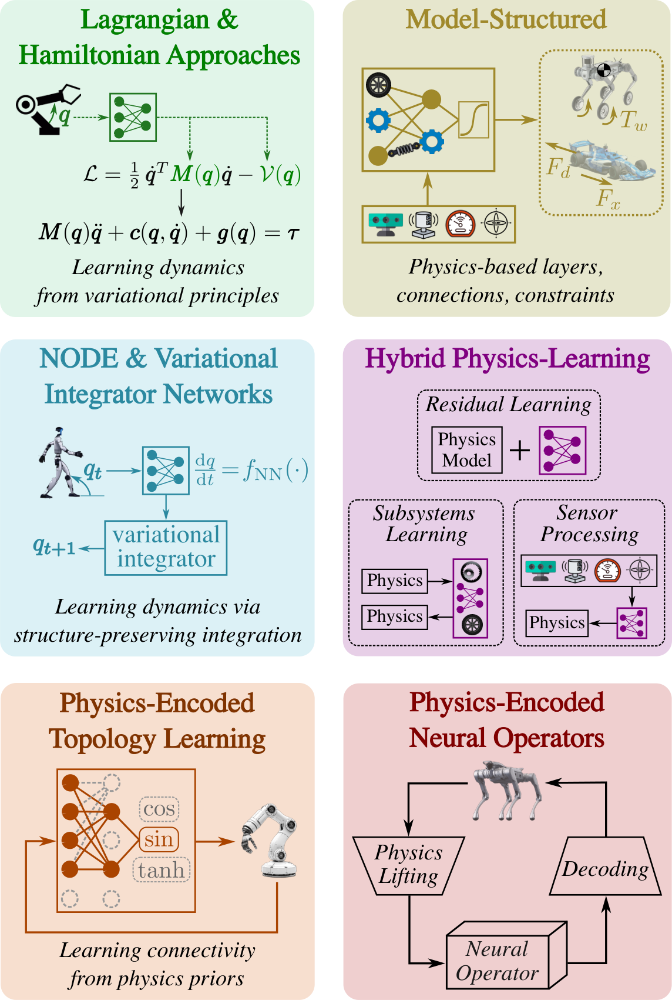

# 机器人学习 · 物理先验融入架构的六类方法

<!-- CATEGORY NAV -->
[Teaser](../README.md) · [Architecture](../../architecture/README.md) · [Element](../../element/README.md) · [总目录](../../CATALOG.md)
<!-- END CATEGORY NAV -->

[所属分类](../README.md) · [总目录](../../CATALOG.md)

**arXiv 2026 · 综述 · 原论文 Figure 5**

## 子图组织

2 列 × 3 行：六类方法各配结构示意、公式或机器人例子。

六类为拉格朗日／哈密顿方法、模型结构方法、神经 ODE／变分积分网络、物理与学习混合方法、拓扑学习、神经算子。它们是综述中的方法家族，不是六个待比较的具体模型。

## 为什么收这张图

六个面板使用相同的色块、标题、中心图示和底部说明组织不同方法家族。每个面板包含公式、网络连接或机器人结构，既能独立阅读，也能共同构成有科学内容的方法全景。

综述 Figure 5 的方法类别总览，原文并非首图；适合作为多子图综述 teaser 的构图参考。整图比较方法家族，归入 Teaser。

## 相近表达

将多个方法家族组织成一个完整全景，并用独立科学示意解释每个类别。 对照查看：[AI4PDE 综述范例](../survey-ai-pde-scope-map/README.md)。

## 可以借鉴

- 统一面板结构，让多类方法保持可比较的阅读节奏。
- 每类只保留最有辨识度的科学对象，避免用大段文字替代示意。
- 标题、主要图示和短说明构成三个清楚层级。

## 可美化的方向（尚未改绘）

- 可根据论文画幅改成 3 列 × 2 行，但需保留各面板的完整科学关系。
- 统一面板内公式大小和短说明行数，保持主要示意的可读性。

## 文件与编辑范围

[作者原始 PDF](original.pdf) · [SVG 转换件](source.svg) · [原始插图定义](figure-inclusion.tex) · [来源与校验记录](metadata.json)

独立 PDF 保留作者原有图形和文本对象；SVG 文字转轮廓。原图中的嵌入位图可移动或替换，不能按矢量节点编辑。

原件来自作者固定版本源码归档；桌面 Illustrator 尚未逐项实测。

## 原始出处

- 论文：[Embedding Physics Priors in Robot Learning: A Survey](https://arxiv.org/abs/2609.22319v1)
- 作者：Piccinini, Mattia；Schulze, Lucas；Plebe, Alice；Saveriano, Matteo；Beckers, Thomas；Gao, Yuan；Arenz, Oleg；Zarrouki, Baha；Wang, Dingrui；Schäfer, Finn Rasmus；Peters, Jan；Betz, Johannes；Papini, Gastone Pietro Rosati
- [作者项目或原文](https://github.com/TUM-AVS/survey-physics-embedded-robot-learning)
- [作者 TeX 源码归档](https://arxiv.org/src/2609.22319v1)；版本 `2609.22319v1`。
- 归档内路径：`figures/physics_encoded.pdf`。原文 PDF 第 6 页，Figure 5。

## 权利与修改记录

所收录版本声明 CC BY 4.0；保留作者署名、原文链接与转换记录。 子图引用的第三方照片、截图、生成结果与原论文图例仍按其原始权利声明使用。

[原文许可声明](https://creativecommons.org/licenses/by/4.0/) · [权利记录](RIGHTS.source.txt)

只复制原件、转换格式和制作预览；所有内容沿用作者原图。

<!-- BEGIN FIGURE LINKS -->
## 关联范例与元素

同论文的其他图：[机器人学习 · 物理先验融入的三路对照](../survey-robot-physics-three-routes/README.md)

**可搭配的现有元素：** [机器人](../../element/svg/tabler-robot.svg) · [网络](../../element/svg/tabler-network.svg) · [正弦信号](../../element/svg/tabler-wave-sine.svg) · [水平双向箭头](../../element/svg/tabler-arrows-right-left.svg)

这些元素按表达功能关联，并非从本论文原图拆出；来源和许可仍以各元素记录为准。

[范例与元素对照表](../../element/with-examples.md) · [元素分类目录](../../element/README.md)
<!-- END FIGURE LINKS -->
