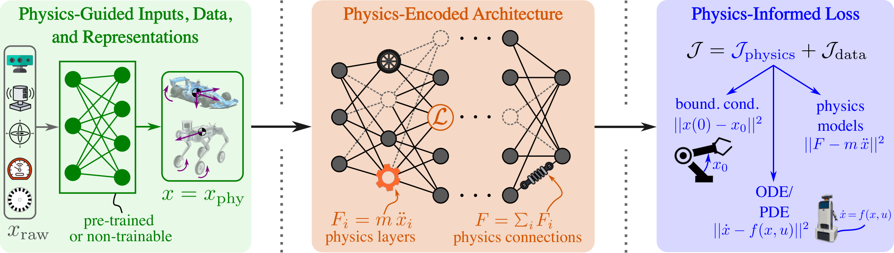
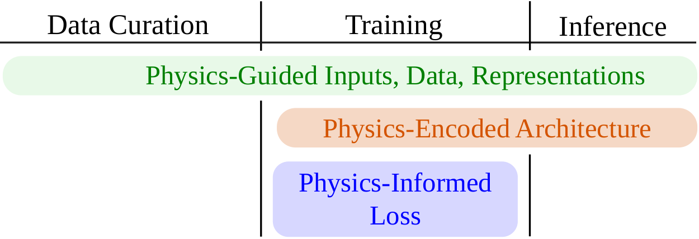

# 机器人学习 · 物理先验融入的三路对照

<!-- CATEGORY NAV -->
[Teaser](../README.md) · [Architecture](../../architecture/README.md) · [Element](../../element/README.md) · [总目录](../../CATALOG.md)
<!-- END CATEGORY NAV -->

[所属分类](../README.md) · [总目录](../../CATALOG.md)

**arXiv 2026 · 综述 · 原论文 Figure 1**

## 子图组织

三栏并列：输入／数据／表示、模型架构、训练损失。

按三种物理先验融入位置计三个面板；内部机器人实例、网络节点与方程是各面板的说明图元。

## 为什么收这张图

三栏沿用相同的物理先验主题，分别用机器人观测、网络内部结构和物理损失方程解释三种融入位置。颜色分区和真实方法示意共同承担信息表达，与多方法对照 teaser 的结构接近。

综述原论文 Figure 1。比较三种物理先验进入学习过程的方式，并提示它们可以组合使用；箭头不表示每种方法都必须经过全部三栏。

## 相近表达

同一物理学习主题下，用并列方法面板和具体科学示意解释不同融入方式。 对照查看：[AI4PDE 综述范例](../survey-ai-pde-physics-data-paradigms/README.md)。

## 可以借鉴

- 每栏有明确标题和独立科学示意，整体以同一主题串联。
- 同类对象采用一致的颜色和线型，具体物理内容用方程和结构表达。
- 可与配套生命周期图对照，进一步区分数据准备、训练和推断阶段。

## 可美化的方向（尚未改绘）

- 改编时可扩大栏间留白，统一三栏公式与标签的视觉层级。
- 保留图示的物理语义，不把三种互补方式误画成强制串行流程。

## 文件与编辑范围

[作者原始 PDF](original.pdf) · [SVG 转换件](source.svg) · [原始插图定义](figure-inclusion.tex) · [来源与校验记录](metadata.json)

独立 PDF 保留作者原有图形和文本对象；SVG 文字转轮廓。原图中的嵌入位图可移动或替换，不能按矢量节点编辑。

原件来自作者固定版本源码归档；桌面 Illustrator 尚未逐项实测。

## 配套原图：先验作用阶段

[作者 PDF](context-lifecycle.pdf) · [SVG 转换件](context-lifecycle.svg)

原文 Figure 3，第 5 页。对照三种融入方式在数据准备、训练和推断阶段的显式参与范围，可与上面的三路对照图搭配使用；配套图不另计一个范例。

## 原始出处

- 论文：[Embedding Physics Priors in Robot Learning: A Survey](https://arxiv.org/abs/2609.22319v1)
- 作者：Piccinini, Mattia；Schulze, Lucas；Plebe, Alice；Saveriano, Matteo；Beckers, Thomas；Gao, Yuan；Arenz, Oleg；Zarrouki, Baha；Wang, Dingrui；Schäfer, Finn Rasmus；Peters, Jan；Betz, Johannes；Papini, Gastone Pietro Rosati
- [作者项目或原文](https://github.com/TUM-AVS/survey-physics-embedded-robot-learning)
- [作者 TeX 源码归档](https://arxiv.org/src/2609.22319v1)；版本 `2609.22319v1`。
- 归档内路径：`figures/overview_physics_injection.pdf`。原文 PDF 第 2 页，Figure 1。

## 权利与修改记录

所收录版本声明 CC BY 4.0；保留作者署名、原文链接与转换记录。 子图引用的第三方照片、截图、生成结果与原论文图例仍按其原始权利声明使用。

[原文许可声明](https://creativecommons.org/licenses/by/4.0/) · [权利记录](RIGHTS.source.txt)

只复制原件、转换格式和制作预览；所有内容沿用作者原图。

<!-- BEGIN FIGURE LINKS -->
## 关联范例与元素

同论文的其他图：[机器人学习 · 物理先验融入架构的六类方法](../survey-robot-physics-six-families/README.md)

**可搭配的现有元素：** [机器人](../../element/svg/tabler-robot.svg) · [浅层神经网络](../../element/svg/towaki-neuralnetwork.svg) · [数据库](../../element/svg/tabler-database.svg) · [文本文件](../../element/svg/tabler-file-text.svg)

这些元素按表达功能关联，并非从本论文原图拆出；来源和许可仍以各元素记录为准。

[范例与元素对照表](../../element/with-examples.md) · [元素分类目录](../../element/README.md)
<!-- END FIGURE LINKS -->
