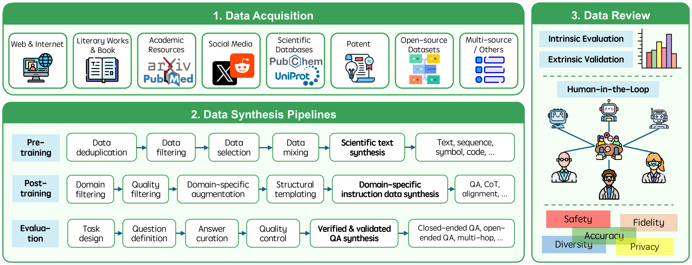

# 科学大模型综述 · 数据获取、构建与审查全景

<!-- CATEGORY NAV -->
[Teaser](../README.md) · [Architecture](../../architecture/README.md) · [Element](../../element/README.md) · [总目录](../../CATALOG.md)
<!-- END CATEGORY NAV -->

[Teaser](../README.md) · [Architecture](../../architecture/README.md) · [Element](../../element/README.md) · [总目录](../../CATALOG.md)

**作者独立 PDF＋SVG 转换件 · 2508.21148v2 · Figure 28**

## 内容与组织

将数据来源、数据构建的三条路径和质量审查放在统一框架中。多行步骤、来源图标和右侧反馈形成有主次的复杂总览，适合借鉴为“上层来源＋中层处理＋侧边约束”的 teaser。

三个主区：上方多源数据获取、下方三条数据构建路径、右侧质量审查与反馈。

按原图编号 1–3 计三个主区；中间构建区含预训练、后训练和评测三条并行路径，上方含八类来源。

综述所收录版本的 Figure 28，原文并非首图；作为综述 teaser 的构图参考。

## 可以借鉴

- 用空间分区区分来源、处理路径和质量反馈。
- 并行路径采用相同的步骤结构，便于横向比较。
- 跨区连线只承担关键关系，局部步骤在区内展开。

## 文件与编辑范围

[作者原始 PDF](original.pdf) · [SVG 转换件](source.svg) · [作者插图定义](figure-inclusion.tex) · [来源与校验记录](metadata.json)

作者独立 PDF 保留分离的矢量框线、连线、原有文字或文字轮廓；转换 SVG 的文字为轮廓。原图含 19 个嵌入位图对象，这些图片可移动或替换，不能按矢量节点编辑。位图对象数不等于子图数量。

在 Illustrator 中打开 PDF 或 SVG 后，可优先调整外围分区、颜色、标签和连接。嵌入照片、截图或图标保留其原始位图属性；桌面 Illustrator 尚未逐项实测。

## 相近范例

[AI4PDE 综述范例](../survey-ai-pde-physics-data-paradigms/README.md)

## 原始出处

- 论文：[A Survey of Scientific Large Language Models: From Data Foundations to Agent Frontiers](https://arxiv.org/abs/2508.21148v2)
- 作者：Hu, Ming；Ma, Chenglong；Li, Wei；Xu, Wanghan；Wu, Jiamin；Hu, Jucheng 等（完整名单见元数据）
- [作者项目或原文](https://uni-medical.github.io/gmai-web/projects/survey-scillm/)
- 固定版本：`2508.21148v2`；原文 PDF 第 46 页，Figure 28。
- [作者 TeX 源码归档](https://arxiv.org/src/2508.21148v2)；成员路径 `fig/data_pipeline5.pdf`。

## 权利与修改记录

所收录版本声明 CC-BY-4.0，保留作者署名、原文链接与转换记录。 第三方照片、Logo、截图或引用图按其原始声明核对；格式可编辑不代表授权可任意改编。

[原文许可](https://creativecommons.org/licenses/by/4.0/) · [权利记录](RIGHTS.source.txt)

作者原件按原字节保存；仅转换显示格式和生成预览，未改绘。

<!-- BEGIN FIGURE LINKS -->
## 关联范例与元素

同论文的其他图：[科学大模型综述 · 六学科环形问答总览](../survey-scillm-six-domain-examples/README.md) · [科学大模型综述 · 五层知识阶梯与发现循环](../survey-scillm-knowledge-levels/README.md)

**可搭配的现有元素：** [数据库](../../element/svg/tabler-database.svg) · [右箭头](../../element/svg/tabler-arrow-right.svg) · [文本文件](../../element/svg/tabler-file-text.svg) · [网络](../../element/svg/tabler-network.svg)

这些元素按表达功能关联，并非从本论文原图拆出；来源和许可仍以各元素记录为准。

[范例与元素对照表](../../element/with-examples.md) · [元素分类目录](../../element/README.md)
<!-- END FIGURE LINKS -->
