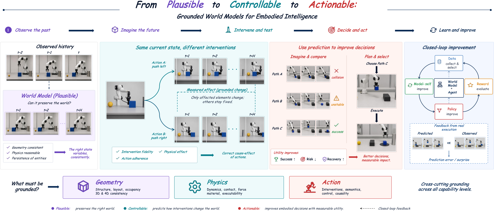

# 世界模型能力递进 · 可信预测、可控干预与决策收益

<!-- CATEGORY NAV -->
[Teaser](../README.md) · [Architecture](../../architecture/README.md) · [Element](../../element/README.md) · [总目录](../../CATALOG.md)
<!-- END CATEGORY NAV -->

[所属分类](../README.md) · [总目录](../../CATALOG.md)

**arXiv 2026 · 预印本综述 · 原论文 Figure 1**

## 为什么收这张图

用同一个机器人操作任务贯穿观察、未来预测、不同动作干预和决策执行，最后接入改进闭环；相同场景反复出现，使抽象能力差异变成可以直接对照的图像证据要求。

综述原文 Figure 1，表达作者从 Plausible 到 Controllable 再到 Actionable 的能力框架；是综述观点示意，不是这些能力已在单一系统中全部实现的实验结论。

## 可以借鉴

- 相同当前状态分出不同动作及其后果，直观表达干预与反事实。
- 用跨栏的同一操作例子连接多个概念层级。
- 底部几何、物理与动作条件单列，和上面的能力递进互相对齐。

## 文件与编辑范围

[作者原始 PDF](original.pdf) · [SVG 转换件](source.svg) · [原始 LaTeX 插图定义](figure-inclusion.tex) · [来源与校验记录](metadata.json)

作者独立 PDF 中的文字与图形对象保留；SVG 文字转为轮廓。原有照片、标识、人物或渲染仍为嵌入位图，可移动替换，不能按矢量节点编辑。

对照原论文页核实了图号和实际用途；独立 PDF 按作者提交的原文件保存。

原始 PDF 来自作者提交的 TeX 归档，未改字节；SVG 是格式转换件，未取得原生 AI 工程。桌面 Illustrator 尚未逐项实测。

## 原始出处

- 论文：[World Models for Embodied Intelligence: From Plausible to Controllable to Actionable](https://arxiv.org/abs/2609.16697v1)
- 作者：Yao, Nanjie, Wang, Hao, Cheng, Chong 等；完整署名见下方。
- [作者项目或仓库](https://3dagentworld.github.io/EmbodiedWM/)
- [论文 TeX 原始归档](https://arxiv.org/src/2609.16697v1)，固定版本 `2609.16697v1`。
- 归档内路径：`fig/teaser.pdf`；原文 PDF 第 3 页，Figure 1。
- [出版与来源依据](https://arxiv.org/abs/2609.16697v1)；出版年份与所收录 arXiv 修订版时间分别记录。

完整作者署名（13 人）

Yao, Nanjie, Wang, Hao, Cheng, Chong, Chen, Zhikang, Li, Wenzhe, Lyu, Jiafei, Shen, Li, Zhao, Peilin, Lu, Zongqing, Huang, Gao, Hoi, Steven, Tao, Dacheng, Ye, Deheng

## 权利与修改记录

所收录 arXiv 版本声明 CC BY 4.0；保留作者署名、原文链接和格式转换说明。图中的第三方照片、标识、模型渲染与引用素材仍需按其原权利声明使用。

[原文许可声明](https://creativecommons.org/licenses/by/4.0/) · [本条权利记录](RIGHTS.source.txt)

只复制作者原件、转换格式和制作预览；没有重绘或新增图形。

<!-- BEGIN FIGURE LINKS -->
## 关联范例与元素

**可搭配的现有元素：** [机器人](../../element/svg/tabler-robot.svg) · [回环箭头](../../element/svg/tabler-arrow-loop-right.svg) · [分流箭头](../../element/svg/tabler-arrows-split.svg) · [目标](../../element/svg/tabler-target.svg)

这些元素按表达功能关联，并非从本论文原图拆出；来源和许可仍以各元素记录为准。

[范例与元素对照表](../../element/with-examples.md) · [元素分类目录](../../element/README.md)
<!-- END FIGURE LINKS -->
