# 原生版式模板

[回到总目录](../../CATALOG.md)

## [Nature 官方 · nature-figure-illustrator-template](nature-official-nature-figure-illustrator-template/README.md)

**原生模板** · 作者已有的画幅与版式母版，保留原生文件；不包含可直接替换内容的模型架构，不计入元素或 teaser 数量。

[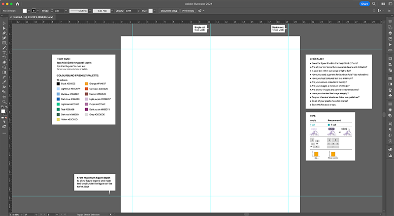](nature-official-nature-figure-illustrator-template/nature-figure-illustrator-template.ait)

## [Scientific Figure Templates · ICML](scientific-figure-icml/README.md)

**原生模板** · 作者已有的画幅与版式母版，保留原生文件；不包含可直接替换内容的模型架构，不计入元素或 teaser 数量。

[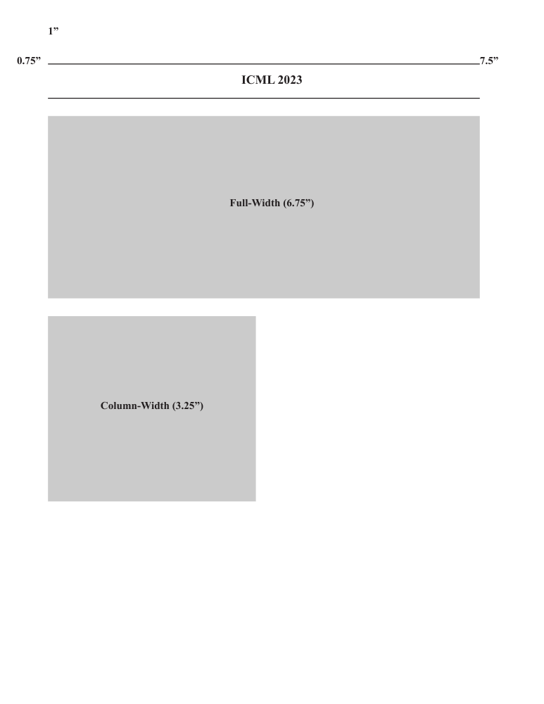](scientific-figure-icml/ICML.ai)

## [Scientific Figure Templates · IEEE-ISBI](scientific-figure-ieee-isbi/README.md)

**原生模板** · 作者已有的画幅与版式母版，保留原生文件；不包含可直接替换内容的模型架构，不计入元素或 teaser 数量。

[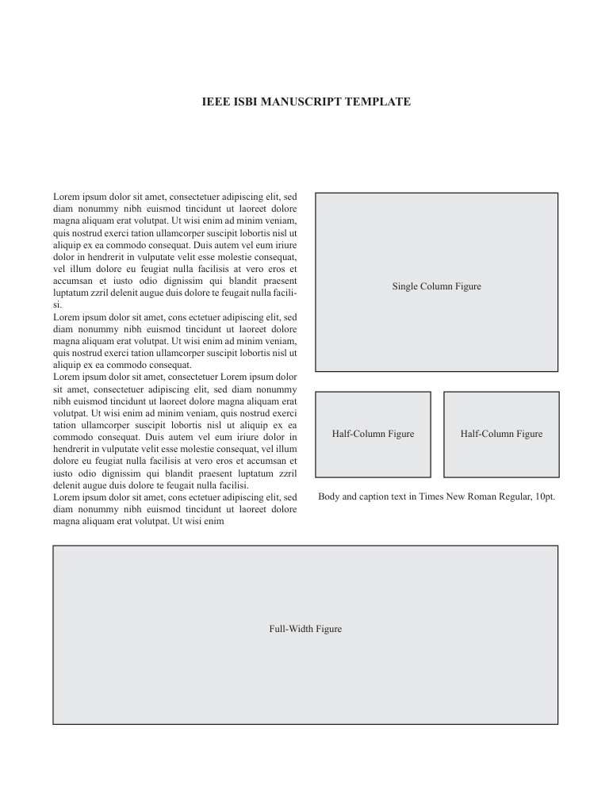](scientific-figure-ieee-isbi/IEEE-ISBI.ai)

## [Scientific Figure Templates · Nature](scientific-figure-nature/README.md)

**原生模板** · 作者已有的画幅与版式母版，保留原生文件；不包含可直接替换内容的模型架构，不计入元素或 teaser 数量。

[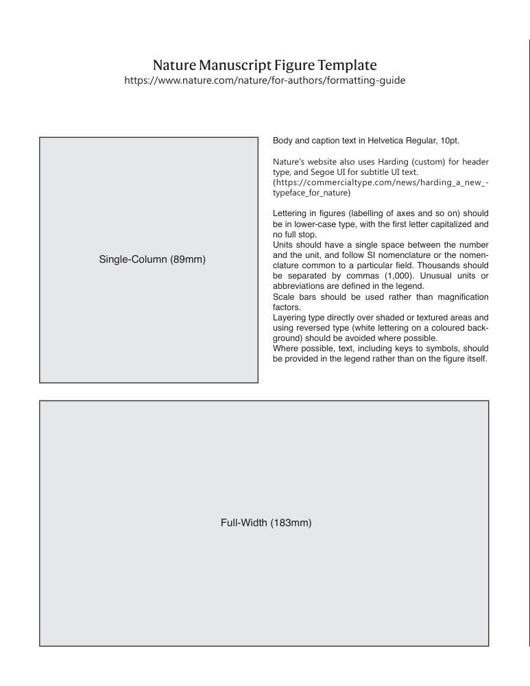](scientific-figure-nature/Nature.ai)

## [SciFigureTemplates · ACSFigureTemplate](scifigure-acsfiguretemplate/README.md)

**原生模板** · 作者已有的画幅与版式母版，保留原生文件；不包含可直接替换内容的模型架构，不计入元素或 teaser 数量。

[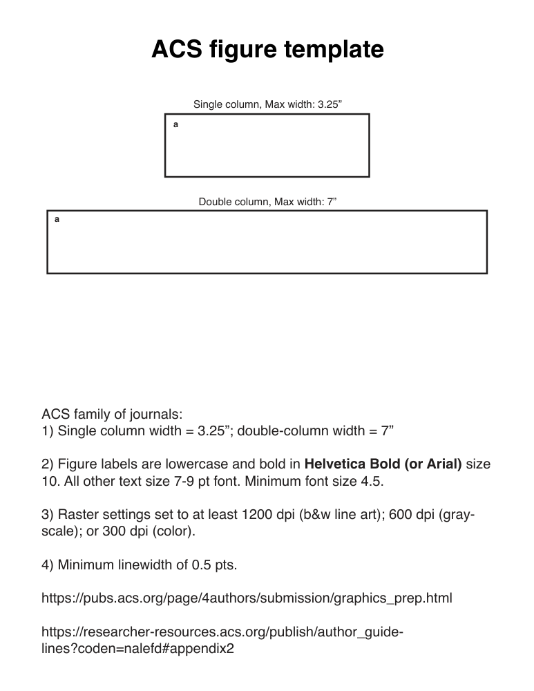](scifigure-acsfiguretemplate/ACSFigureTemplate.ait)

## [SciFigureTemplates · AIPFigureTemplate](scifigure-aipfiguretemplate/README.md)

**原生模板** · 作者已有的画幅与版式母版，保留原生文件；不包含可直接替换内容的模型架构，不计入元素或 teaser 数量。

[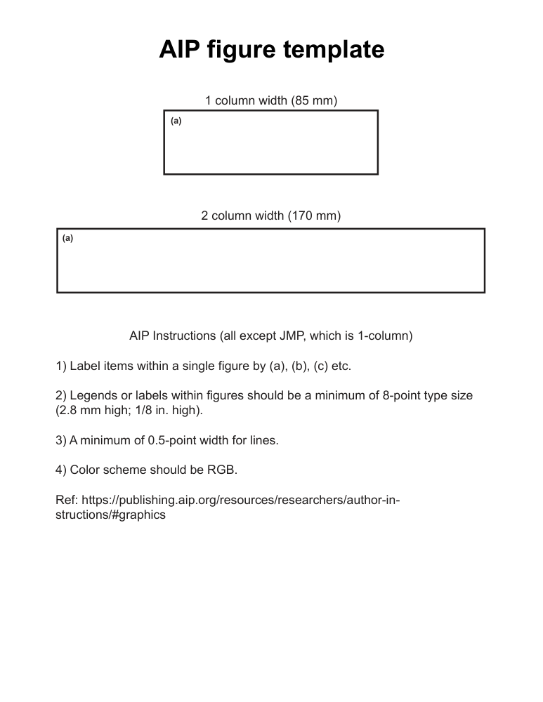](scifigure-aipfiguretemplate/AIPFigureTemplate.ait)

## [SciFigureTemplates · APSFigureTemplate](scifigure-apsfiguretemplate/README.md)

**原生模板** · 作者已有的画幅与版式母版，保留原生文件；不包含可直接替换内容的模型架构，不计入元素或 teaser 数量。

[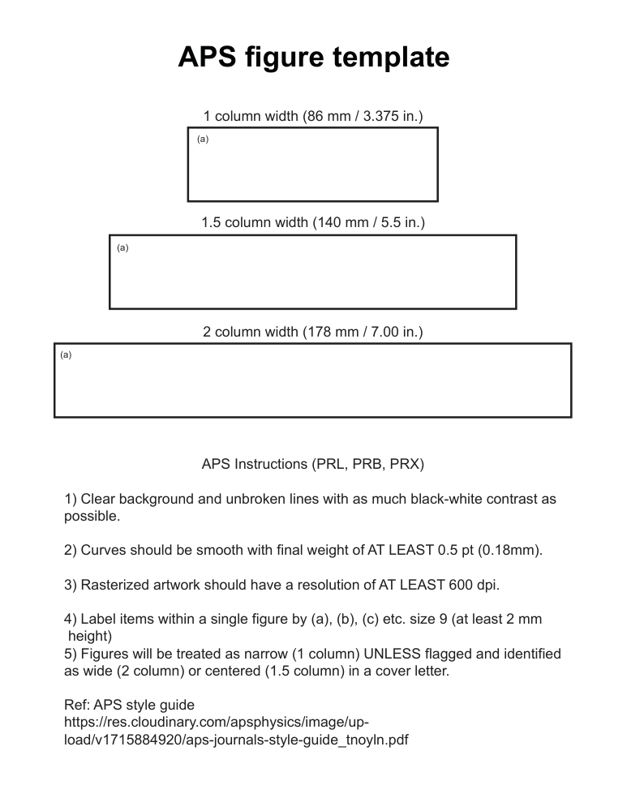](scifigure-apsfiguretemplate/APSFigureTemplate.ait)

## [SciFigureTemplates · IOPFigureTemplate](scifigure-iopfiguretemplate/README.md)

**原生模板** · 作者已有的画幅与版式母版，保留原生文件；不包含可直接替换内容的模型架构，不计入元素或 teaser 数量。

[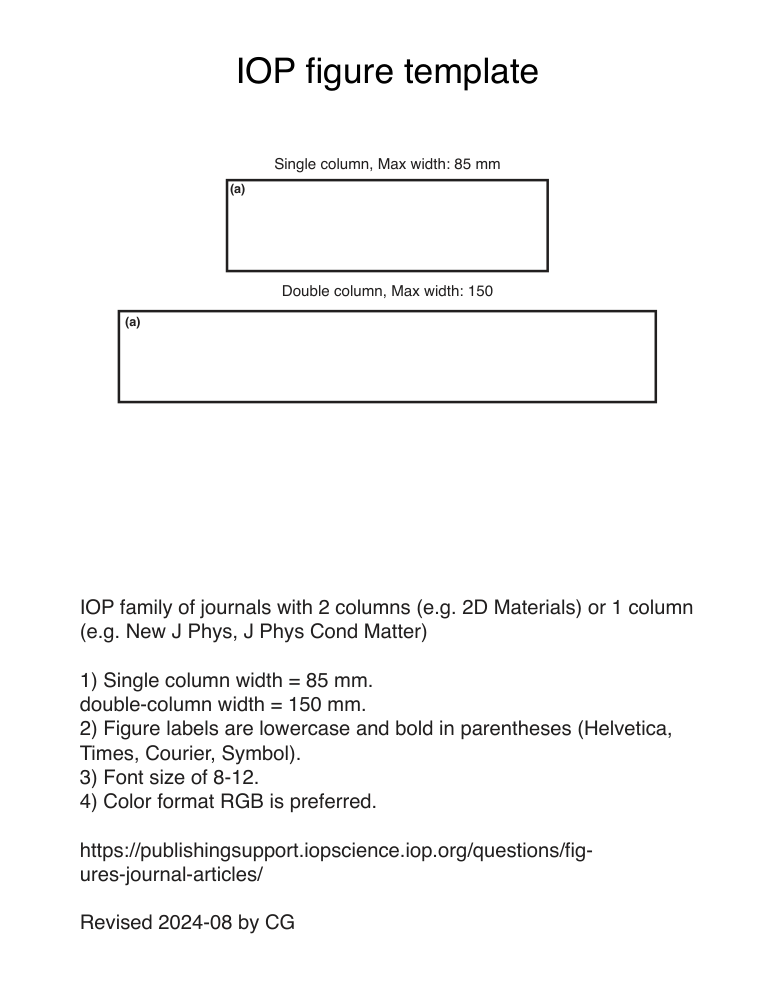](scifigure-iopfiguretemplate/IOPFigureTemplate.ait)

## [SciFigureTemplates · NatureFigureTemplate](scifigure-naturefiguretemplate/README.md)

**原生模板** · 作者已有的画幅与版式母版，保留原生文件；不包含可直接替换内容的模型架构，不计入元素或 teaser 数量。

[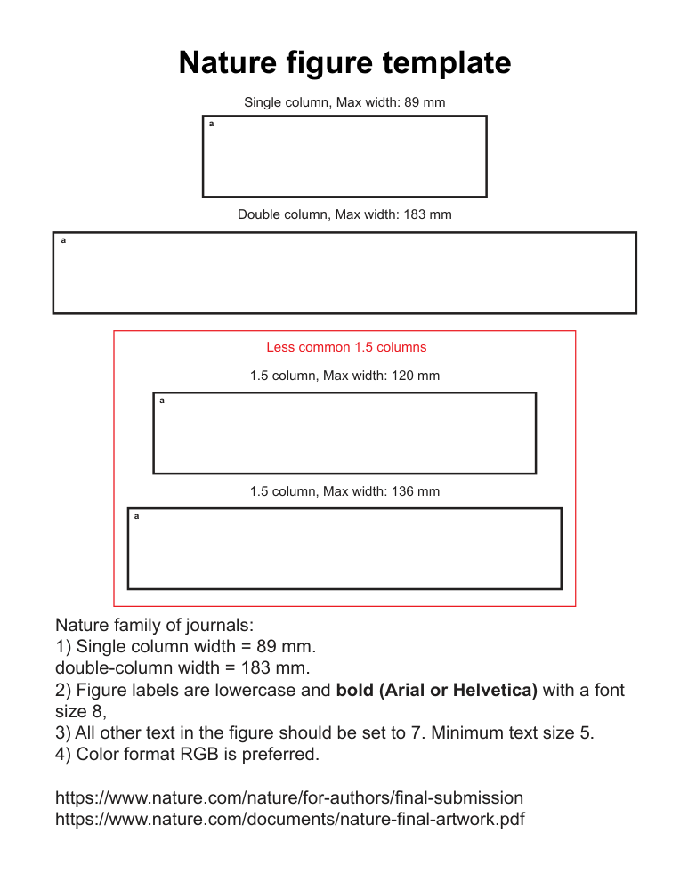](scifigure-naturefiguretemplate/NatureFigureTemplate.ait)

## [SciFigureTemplates · SciAdvancesFigureTemplate_2026-08](scifigure-sciadvancesfiguretemplate-2026-08/README.md)

**原生模板** · 作者已有的画幅与版式母版，保留原生文件；不包含可直接替换内容的模型架构，不计入元素或 teaser 数量。

[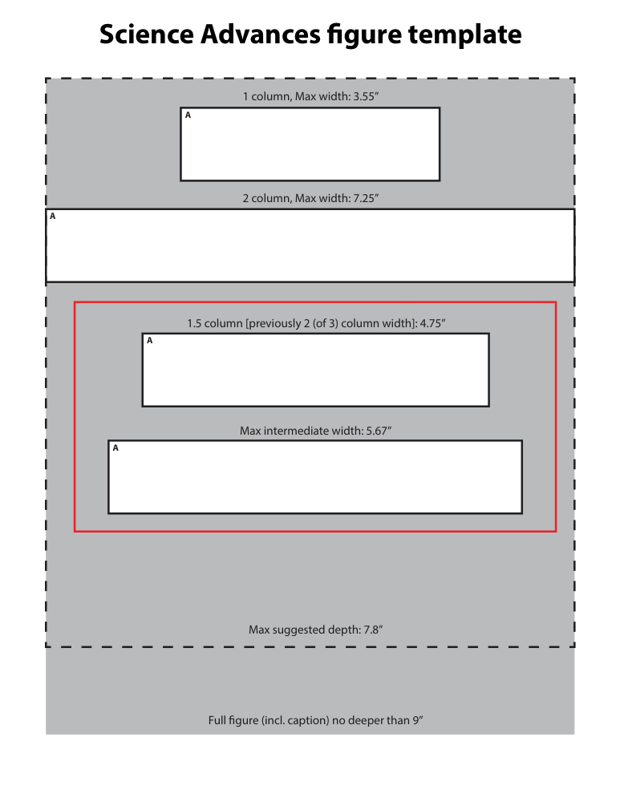](scifigure-sciadvancesfiguretemplate-2026-08/SciAdvancesFigureTemplate_2026-08.ait)

## [SciFigureTemplates · ScienceFigureTemplate_2026-08](scifigure-sciencefiguretemplate-2026-08/README.md)

**原生模板** · 作者已有的画幅与版式母版，保留原生文件；不包含可直接替换内容的模型架构，不计入元素或 teaser 数量。

[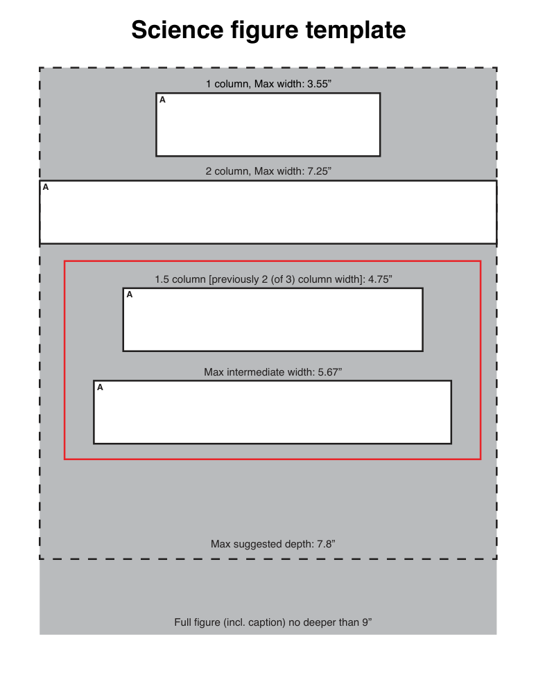](scifigure-sciencefiguretemplate-2026-08/ScienceFigureTemplate_2026-08.ait)
