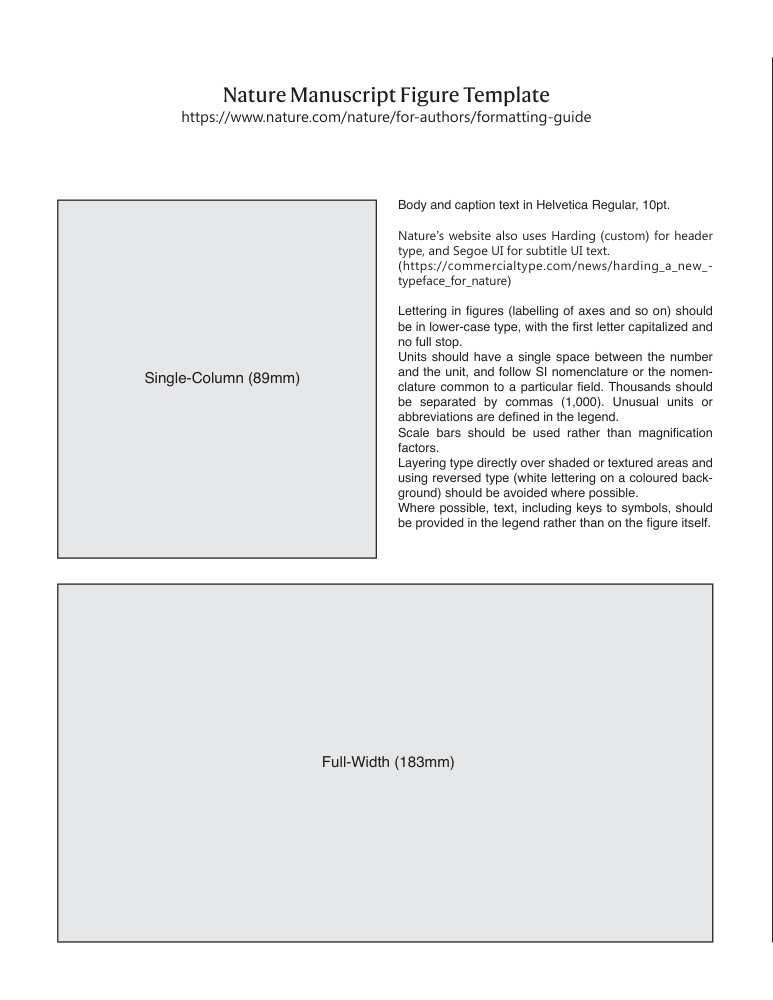

# Scientific Figure Templates · Nature

作者已有的画幅与版式母版，保留原生文件；不包含可直接替换内容的模型架构，不计入元素或 teaser 数量。

[原生文件](Nature.ai) · [来源记录](metadata.json) · [原网站](https://github.com/j6k4m8/Scientific-Figure-Templates)

模板中的规范可能有版本差异，保留其原作者说明。

预览来自作者配套 PDF 或官方网页，原生文件保持原样；是否自带可渲染的 PDF 图形层见 metadata.json。
